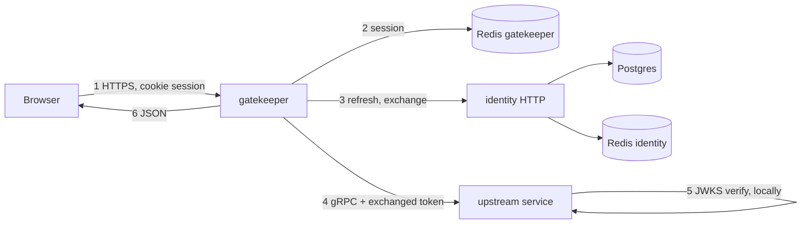
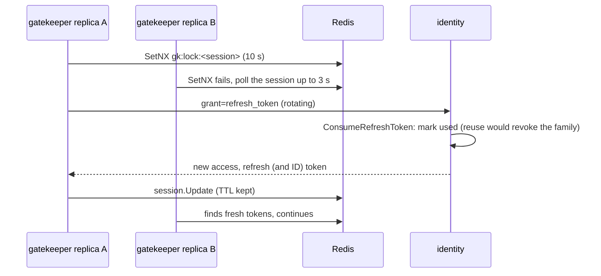
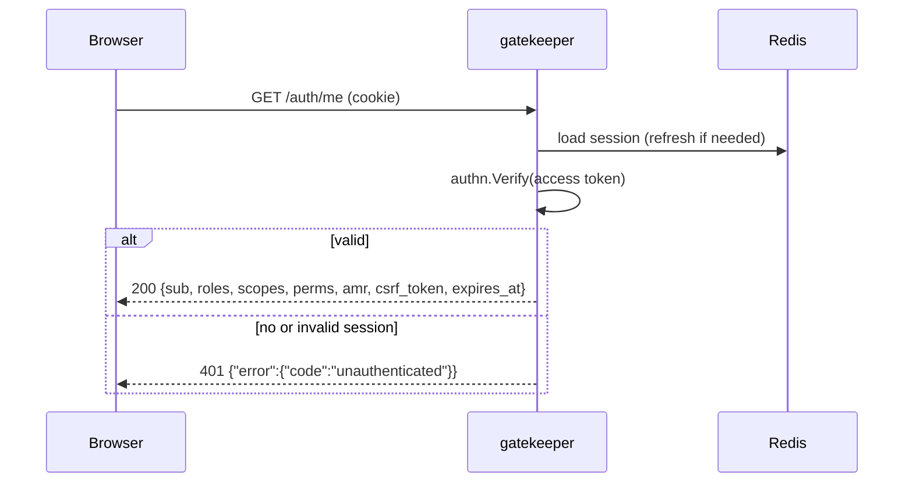
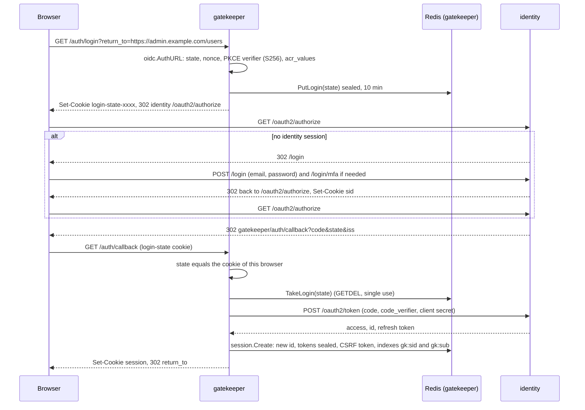

# What happens when a user calls an API

This document follows one HTTP request from the browser to the service and back, step by step.
It covers two kinds of calls:

- an **auth API**: the endpoints under `/auth/*` of the gatekeeper (`/auth/login`, `/auth/callback`,
  `/auth/me`, `/auth/logout`). They handle the session, not business data.
- a **normal API**: any route of `gatekeeper/routes.yaml`, for example `GET /api/users`. It becomes
  one gRPC call on an upstream service (here `identity`).

For the full list of identity flows see [flows.md](flows.md). Paths below are relative to the
`gatekeeper` folder unless they start with `identity/` or `gocommon/`.

## 1. Who is who

| Actor | What it is | What it holds |
| --- | --- | --- |
| Browser | The web app (admin app) | Only the cookie `session` (opaque, `HttpOnly`) and the CSRF token returned by `/auth/me` |
| gatekeeper | Public gateway (BFF) | Session in Redis (`gk:sess:*`), with the access, refresh and ID token sealed with AES-GCM |
| identity | OAuth 2.0 / OIDC provider | Users, roles, clients, refresh tokens (Postgres), SSO session, denylist, cutoff (Redis) |
| upstream service | Any gRPC service behind the gateway (identity itself, courier, ...) | Nothing about the user: it trusts the JWT it receives |

Three different tokens appear in the flow. Do not mix them up:

| Token | Audience (`aud`) | Lifetime | Who holds it | Used for |
| --- | --- | --- | --- | --- |
| User access token | `GATEKEEPER_AUDIENCE` (the `resource` of the gatekeeper client) | `IDENTITY_ACCESS_TOKEN_TTL`, 10 min | gatekeeper session (Redis) | Proves who the user is to the gatekeeper |
| Exchanged token | the route audience (default: the upstream name, for example `identity`) | `IDENTITY_EXCHANGE_TOKEN_TTL`, 2 min, never longer than the user token | gatekeeper memory cache | Sent to the upstream as `authorization: Bearer`; has `act = gatekeeper` |
| Refresh token | none (opaque) | `IDENTITY_REFRESH_TOKEN_TTL`, 720 h | gatekeeper session (Redis) | Gets a new user access token |

## 2. The path of a request



## 3. Part A — a normal API: `GET /api/users?query=ann`

Route (from `routes.yaml`):

```yaml
- {http: "GET /api/users", grpc: identity.v1.IdentityService/ListUsers, upstream: identity, permission: "identity:user:read"}
```

All steps are in `internal/bff/bff.go`, function `Server.route`, unless noted.

### 3.1 Sequence (happy path)

```mermaid
sequenceDiagram
    participant B as Browser
    participant G as gatekeeper
    participant R as Redis (gatekeeper)
    participant I as identity (HTTP :8080)
    participant S as identity gRPC (:9090)

    B->>G: GET /api/users?query=ann (Cookie: __Host-session, Origin)
    G->>G: middleware: nosniff, no-store; cors (Origin in UI origins)
    G->>R: session.Get (open sealed value, slide idle TTL)
    opt access token expires in less than 30 s
        G->>R: Lock gk:lock
        G->>I: POST /oauth2/token grant=refresh_token
        I-->>G: new access and refresh token
        G->>R: session.Update
    end
    G->>G: authn.Verify(access token): signature (JWKS), iss, aud, exp, type
    G->>G: Principal.Can("identity:user:read")
    G->>G: requestJSON: query + path params -> {"query":"ann"}
    G->>I: POST /oauth2/token grant=token-exchange, audience=identity (cache miss)
    I-->>G: exchanged token (2 min, act=gatekeeper)
    G->>S: ListUsers {"query":"ann"} (authorization: Bearer exchanged token)
    S->>S: JWTAuth, then service.Permissions: identity:user:read
    S-->>G: ListUsersResponse (protobuf)
    G-->>B: 200 JSON (protojson, unpopulated fields included)
```

### 3.2 The steps in detail

| # | Step | Code | Result if it fails |
| --- | --- | --- | --- |
| 1 | Response headers `X-Content-Type-Options`, `Cache-Control: no-store`. | `Server.Routes` (middleware) | n/a |
| 2 | CORS: the `Origin` must be in `GATEKEEPER_UI_ORIGINS`, otherwise no CORS headers (the browser blocks the response). A preflight `OPTIONS` is answered here with 204, before authentication. | `Server.cors` | Browser error, the request never reaches the handler |
| 3 | Choose the mode: any `Authorization` header means Bearer mode, otherwise cookie mode. | `isBearer` | n/a |
| 4 | Cookie mode: read cookie `__Host-session` (`session` on local http). | `Server.cookie` | 401 `unauthenticated` "sign in first" |
| 5 | Load the session from Redis: key `gk:sess:<sha256(cookie)>`, value opened with AES-GCM (the AAD is the cookie hash). Slides the idle TTL (8 h) but never beyond the absolute TTL (168 h). | `session.Store.Get` | Not found: cookie cleared, 401. Redis down: 503 `unavailable` |
| 6 | If the access token expires in less than 30 s, refresh it (one replica at a time, see 3.3). | `Server.refresh` | Refresh token rejected: session deleted, 401 "sign in again". Identity down: 503 |
| 7 | Verify the access token locally with the JWKS of identity: signature, issuer, audience, expiry, `typ=access`. Fails closed. | `authn.Verify` (`gocommon/authn/verify.go`) | Invalid: session deleted, cookie cleared, 401. JWKS unreachable: 503 (not a logout) |
| 8 | Put the `Principal` (sub, roles, scopes, perms, amr) on the context. | `httpx.SetPrincipal` | n/a |
| 9 | State-changing method (anything but GET) in cookie mode: check `Origin` is a UI origin and header `Csrf-Token` equals the session CSRF token (constant time). | `Server.checkWrite` | 403 `bad_origin` or `bad_csrf` |
| 10 | Permission: the route is `public` (any signed-in user) or `Principal.Can(route.Permission)` (wildcards apply). This is the early 403. | `Server.route`, `authz` | 403 `forbidden` |
| 11 | Build the gRPC request as JSON: JSON body (non-GET, `Content-Type: application/json`, at most 1 MiB), then the query string, then path parameters (path wins). | `Server.requestJSON` | 400 `invalid_request` |
| 12 | Exchange the token: the user access token for a token with `aud` = route audience. Cached per (subject token, audience, scope) until shortly before expiry; concurrent calls share one request. | `tokenexchange.Client.ExchangeToken` | `ErrDenied`: 403 `forbidden`. Any other error: 502 `unavailable` |
| 13 | Resolve the gRPC method (descriptor set, or reflection with a service token; cached 10 min), build the dynamic message with `protojson`. Unknown JSON fields are a 400. | `proxy.Proxy.resolve`, `Call` | 400 `invalid_request` (bad JSON), 502 `unavailable` (cannot resolve or dial) |
| 14 | Call the upstream over gRPC with `authorization: Bearer <exchanged token>`. | `proxy.Proxy.Call` | gRPC error, mapped in step 17 |
| 15 | The upstream authenticates: `grpcserver.JWTAuth` verifies the token with the JWKS (issuer, audience `identity`, expiry) and builds the `Principal`. | `gocommon/grpcserver/jwtauth.go` | Unauthenticated |
| 16 | The upstream authorizes: `WithMethodPermissions(service.Permissions)`. The method must be in the map (deny by default) and the principal must hold the permission. Then the handler runs (`service.ListUsers`). | `checkMethod`, `identity/internal/service/service.go` | PermissionDenied |
| 17 | Map the result: success becomes `200` with `application/json`; a gRPC error becomes HTTP through `mapCode` (see the table in [flows.md](flows.md), section 10.6). For 5xx the message is replaced, details only in the log. | `Server.writeError`, `mapCode` | See table |

### 3.3 Token refresh in cookie mode

The user access token lives 10 minutes. The browser does not know: the gatekeeper refreshes it
before use.



Why the lock: two replicas using one refresh token look like theft to identity
(`store.ConsumeRefreshToken` revokes the whole family on reuse).

### 3.4 What the token exchange checks in identity

`POST /oauth2/token` with `grant_type=urn:ietf:params:oauth:grant-type:token-exchange`
(`oauth.grantExchange`, then `token.Service.Exchange`):

1. The caller is the gatekeeper client: confidential, grant token-exchange allowed (`authenticateClient`).
2. The subject token is one of our access tokens whose `aud` is the gatekeeper `resource`, not on the
   denylist, not issued before the user cutoff (`VerifyAccess`, `checkLive`).
3. A row in `identity_exchange_policies` for (gatekeeper, requested audience) must exist, and the delegation
   depth must fit `max_chain_depth`.
4. The user must still be active. Roles and permissions are read from the database now, not copied
   from the old token, then cut to the audience (`FilterPerms`).
5. The scope can only narrow (`NarrowScope`).
6. The new token: `aud` = requested audience, 2 minutes at most, `act = {sub: gatekeeper}`.

Missing policy, disabled user or an unknown audience all end as `access_denied` or `invalid_grant`,
which the gatekeeper turns into 403.

### 3.5 What the response looks like

```json
{"users": [{"id": "…", "email": "ann@example.com", "name": "Ann", "locale": "", "disabled": false,
            "roles": ["admin"], "mfaEnabled": true, "mfaEnforced": false, "createdAt": "1735000000"}],
 "nextPageToken": ""}
```

Fields use the protobuf JSON names (camelCase). Empty fields are present (`EmitUnpopulated`).
Errors always have this form:

```json
{"error": {"code": "forbidden", "message": "you are not allowed to do this"}}
```

### 3.6 A write call: `PUT /api/users/{user_id}/disabled`

Same steps, with these differences:

- Step 9 applies: the browser sends `Origin` and `Csrf-Token` (the value comes from `GET /auth/me`,
  field `csrf_token`).
- Step 11: body `{"disabled": true}` plus path parameter `user_id`, merged into one JSON object.
- Step 16: `identity:user:write`. `service.SetUserDisabled` disables the user and calls
  `account.RevokeUserAccess` (sessions, refresh tokens, cutoff, back-channel logout).

### 3.7 Bearer mode (mobile app or service)

A client that sends `Authorization: Bearer <access token for the gatekeeper audience>`:

- Step 3 selects `authenticateBearer`: the token is verified locally (`authn.Verify`). No session
  is read or written, no CSRF or Origin check (those protect browser cookies).
- The client refreshes its own tokens with identity. A revoked token stays valid until it expires.
- Steps 10 to 17 are the same. The access token is the subject token of the exchange.
- A bad or malformed header is a 401 with `WWW-Authenticate: Bearer`. There is never a fallback to the cookie.

## 4. Part B — an auth API

These endpoints are registered in `Server.Routes` and are not part of `routes.yaml`
(`/auth/*` is reserved, so a route cannot take the same path). Most of them do not call an upstream.

| Endpoint | Auth needed | Calls | Result |
| --- | --- | --- | --- |
| `GET /auth/login` | no | identity (redirect only) | 302 to identity `/oauth2/authorize` |
| `GET /auth/callback` | no (state cookie) | identity `/oauth2/token` | session created, 302 to `return_to` |
| `GET /auth/me` | session or Bearer | none (or a refresh) | JSON about the caller |
| `POST /auth/logout` | session, Origin and CSRF | identity `/oauth2/revoke` | JSON with `logout_url` |
| `POST /auth/backchannel-logout` | logout token signed by identity | none | sessions deleted |

### 4.1 `GET /auth/me` — "who am I"

The web app calls this at start-up. It is the cheapest way to know whether the user is signed in
and to get the CSRF token.



Steps 3 to 8 of section 3.2 only. The app uses the answer like this:

- `200`: store `csrf_token` in memory, show the UI according to `perms`.
- `401`: send the browser to `/auth/login?return_to=<page>`.
- `amr` tells whether this login used a second factor (`["pwd","otp"]`).

### 4.2 `GET /auth/login` then `GET /auth/callback` — sign in



Code: `Server.login`, `Server.callback` (gatekeeper) and `Server.authorize`, `loginSubmit`,
`mfaSubmit`, `grantCode` (identity, see [flows.md](flows.md) sections 4 and 5.1).

Failure cases of the callback:

| Case | Response |
| --- | --- |
| `state` missing or not equal to this browser's cookie | 400 `invalid_state` |
| `error` in the query (user refused, `login_required`, ...) | 401 `login_failed` |
| login state expired or already used | 400 `invalid_state` |
| code exchange refused (wrong code, PKCE mismatch) | 401 `login_failed` |
| ID token without `sub` | 401 `login_failed` |

If the user already has an identity session (SSO), no login page is shown: identity redirects
straight back with a code.

### 4.3 `POST /auth/logout`

1. `checkWrite` (Origin and `Csrf-Token`). Without a session it still answers 200 with the logout URL.
2. Delete the session in Redis, clear the cookie.
3. Revoke the refresh token at identity (`POST /oauth2/revoke`). A failure is only logged.
4. Answer `{"logout_url": "<identity>/oauth2/logout?id_token_hint=…&post_logout_redirect_uri=…"}`.
5. The web app navigates to `logout_url`. Identity ends its SSO session, sends back-channel logout to every client
   of the session, and redirects to the registered `post_logout_redirect_uri`.

`return_to` must be a UI origin and registered as a post-logout URI of the client, otherwise
identity shows its own "signed out" page.

### 4.4 `POST /auth/backchannel-logout`

Called by identity, not by a browser. Identity posts `logout_token` (a JWT) when a session ends
for any reason: logout in another app, password reset, user disabled, MFA reset.

1. `oidc.VerifyLogoutToken`: signature, issuer, audience, event, `sid` or `sub`.
2. With `sid`: delete the gatekeeper sessions made from that identity session (`gk:sid:<sid>`).
   Without it: delete all sessions of the user (`gk:sub:<sub>`).
3. 200. A bad token is 400, a Redis failure is 503 (identity retries 3 times).

## 5. Error reference

| Status | `error.code` | Where it comes from | What the app should do |
| --- | --- | --- | --- |
| 401 | `unauthenticated` | no session, session expired, token invalid, refresh token rejected | Go to `/auth/login` |
| 403 | `bad_origin`, `bad_csrf` | `checkWrite` | Send `Origin` of a UI origin and the `Csrf-Token` from `/auth/me` |
| 403 | `forbidden` | `Principal.Can`, exchange denied, upstream PermissionDenied | Show "not allowed", do not retry |
| 400 | `invalid_request` | bad JSON, wrong `Content-Type`, unknown field | Fix the request |
| 400 | `invalid_argument` | upstream InvalidArgument (for example weak password) | Show `message` |
| 404, 409, 412 | `not_found`, `conflict`, `failed_precondition` | upstream | Show `message` |
| 429 | `rate_limited` | upstream ResourceExhausted | Retry later |
| 502 | `unavailable`, `upstream_auth` | exchange failed, upstream not reachable, upstream refused the gatekeeper token | Retry, then alert (it is a platform problem) |
| 503 | `unavailable` | Redis, identity or JWKS unreachable | Retry |
| 504 | `timeout` | upstream deadline | Retry |

## 6. Scenarios

### 6.1 First visit, not signed in

1. `GET /auth/me` returns 401.
2. The app navigates to `/auth/login?return_to=…`. Section 4.2 runs.
3. The browser lands on `return_to` with a session. `GET /auth/me` now returns 200.

### 6.2 Signed in, access token expired while the page was open

The next API call finds `expires_at` within 30 seconds, refreshes under the lock (section 3.3),
and goes on. The user sees nothing. If identity says the refresh token is invalid (revoked,
expired after 720 h, reused), the session is deleted and the call returns 401.

### 6.3 The user has no permission

The token holds `perms` of the user at login or refresh time. `Principal.Can` refuses at step 10
with 403 and no call is made. If the roles changed after the token was issued, the early check uses the old list
until the next refresh (10 minutes at most), but the upstream always uses the permissions that identity reads
from the database at exchange time, so a removed permission is refused there (step 16).

### 6.4 An admin disables a user who is signed in

1. `SetUserDisabled` then `RevokeUserAccess`: identity sessions deleted, refresh tokens revoked, cutoff set.
2. Back-channel logout reaches `/auth/backchannel-logout`: the gatekeeper sessions of that user are deleted.
3. The next call of the user has no session: 401.
4. A Bearer client keeps a valid access token until it expires (at most 10 minutes), but exchange refuses it at once
   (cutoff), so no upstream call succeeds.

### 6.5 A new service

To expose `courier` through the gateway:

1. Add the upstream (chart value `routes.upstreams`) and routes with `permission` in `routes.yaml`.
2. In identity: `exchange set --client gatekeeper --audience courier`, and make sure the roles of the users
   include the `courier:*` permissions.
3. Nothing changes in the flow: steps 10 to 17 run with `aud = courier`.

## 7. Summary of what protects what

| Threat | Protection | Step |
| --- | --- | --- |
| Token stolen from the browser | The browser never has a token, only an opaque `HttpOnly` cookie | 4, 5 |
| Redis dump | Tokens sealed with AES-GCM, session keys hashed | 5 |
| Cross-site request | `SameSite=Lax`, CORS allow list, `Origin` and `Csrf-Token` | 2, 9 |
| Stolen user token used on another service | The exchanged token has one audience, 2 minutes, and the exchange policy decides | 12 |
| A service gets the permissions of another service | `FilterPerms(audience)` | 12 |
| Forgotten permission check in an upstream | `WithMethodPermissions` is deny by default | 16 |
| Parallel refresh looks like theft | Lock `gk:lock` | 6 |
| User disabled or password changed | Cutoff, back-channel logout, session deletion | 6.4 |
