# Identity flows

This document describes every flow of `identity` and names the code that handles each step.
Paths are relative to the `identity` folder, except section 10, which is about `../gatekeeper`. Functions are referenced by name (line numbers
change too often to be useful).

## 1. Map of the code

| Package | Role |
| --- | --- |
| `cmd/identity/main.go` | Wires everything: Postgres, Redis, keys, token service, account service, gRPC server and the HTTP server. Runs the hourly refresh token cleanup (`cleanup`). |
| `cmd/identity-setup/main.go` | Initial setup, run once as a Kubernetes Job (first admin, clients, exchange policies). Talks straight to Postgres (no gRPC, no Redis). |
| `internal/setup` | The setup logic: config parsing, admin only when none exists, client reconcile, exchange policies. |
| `internal/oauth` | HTTP side: discovery, authorize, login, MFA pages, token, revoke, introspect, userinfo, logout, password reset, account MFA page. |
| `internal/account` | Logic shared by the HTTP pages, the gRPC API: password login, MFA, password reset, revocation, back-channel logout. |
| `internal/token` | Signs access, ID and logout JWTs. Verifies our own tokens. Implements token exchange (RFC 8693). |
| `internal/service` | gRPC `IdentityService` (administration) and the permission of each RPC. |
| `internal/state` | Redis: SSO sessions, authorization codes, MFA challenges, token denylist, user cutoff, rate limits. |
| `internal/store` | Postgres: users, roles, clients, refresh tokens, MFA factors, reset tokens, exchange policies. |
| `internal/mfa` | TOTP (on top of `gocommon/otp`), recovery codes, AES-GCM sealing of the TOTP secret. |
| `internal/password` | argon2id hashing, password policy, random values, token digests. |
| `internal/keys` | Loads the signing key and the retired keys that stay in the JWKS. |
| `internal/notify` | E-mails through courier (`Courier`), or `Log` / `None` for local runs. |
| `internal/appconfig` | Environment variables (`IDENTITY_*`, `POSTGRES_*`, `REDIS_*`). |

Two listeners run in one process:

- HTTP (`HTTP_PORT`, default 8080): `oauth.Server.Routes` in `internal/oauth/server.go`.
- gRPC (`PORT`, default 9090): `service.Service` registered in `cmd/identity/main.go`.

### HTTP routes

| Route | Handler (`internal/oauth`) |
| --- | --- |
| `GET /.well-known/openid-configuration` | `discovery` (`authorize.go`) |
| `GET /.well-known/jwks.json` | `jwks` (`authorize.go`) |
| `GET /oauth2/authorize` | `authorize` (`authorize.go`) |
| `POST /oauth2/token` | `tokenEndpoint` (`tokens.go`) |
| `POST /oauth2/revoke` | `revoke` (`tokens.go`) |
| `POST /oauth2/introspect` | `introspect` (`tokens.go`) |
| `GET, POST /userinfo` | `userinfo` (`tokens.go`) |
| `GET, POST /oauth2/logout` | `endSession` (`logout.go`) |
| `GET /login`, `/login/mfa`, `/login/password`, `/register`, `/password/forgot`, `/password/reset`, `/password/set`, `/account/mfa`, `/logout`, `/error` | `spa` (`server.go`): `index.html` of the sign in app (`IDENTITY_UI_DIR`); the app routes itself |
| `GET /assets/*`, `/logo.svg`, `/theme-init.js` | files of the sign in app (`pages` in `server.go`) |
| `GET /auth-api/csrf` | `csrfToken`: sets the `csrf` cookie, returns the token |
| `POST /auth-api/login` | `apiLogin` (`authapi.go`) |
| `GET, POST /auth-api/login/mfa` | `apiMFACheck`, `apiMFA` |
| `GET, POST /auth-api/login/password` | `apiPasswordChangeCheck`, `apiPasswordChange`: forced change of a temporary password |
| `POST /auth-api/register` | `apiRegister`: 404 unless `IDENTITY_REGISTRATION_ENABLED`; `{email, name, locale}`; `account.Register` creates the user (no password) with `IDENTITY_REGISTRATION_ROLE`; what follows depends on the setting `registration_requires_approval` (see "Registration" below): the welcome mail at once, or a wait for an administrator. The answer is `{}` whether or not the address had an account (nothing is sent to an existing one); only the per-IP limit answers 429 |
| `POST /auth-api/password/forgot` | `apiForgot` |
| `GET, POST /auth-api/password/reset` | `apiResetCheck`, `apiReset` |
| `GET, POST /auth-api/account/mfa`, `POST /auth-api/account/mfa/disable` | `apiAccountMFA`, `apiAccountMFAConfirm`, `apiAccountMFADisable` |
| `POST /auth-api/passkey/login/begin`, `/auth-api/passkey/login/finish` | `apiPasskeyLoginBegin`, `apiPasskeyLoginFinish` (`authapi_passkey.go`): sign in with a passkey (section 4.5) |
| `POST /auth-api/login/mfa/passkey/begin`, `/auth-api/login/mfa/passkey/finish` | `apiMFAPasskeyBegin`, `apiMFAPasskeyFinish`: the passkey as the second factor (section 4.5) |
| `GET /auth-api/account/passkeys`, `POST .../begin`, `POST .../finish`, `PATCH, DELETE .../{id}` | `apiPasskeyList`, `apiPasskeyAddBegin`, `apiPasskeyAddFinish`, `apiPasskeyRename`, `apiPasskeyDelete` (section 8.5) |
| `GET /auth-api/session` | `apiSession`: 401 without a session, else `{"redirect": IDENTITY_PORTAL_URL}` (the login page's "already signed in" check) |
| `POST /auth-api/logout` | `apiLogout`: sign out of the confirmation page of `/logout` |

A sign in without a valid `return_to` (the user typed `/login`) ends at the portal (`IDENTITY_PORTAL_URL`);
it is not an MFA step. MFA enrollment comes only when the account must have it (mode `required`
or enforced for the user), and then continues to the portal.

The sign in pages are a React app (`web/apps/auth`, image `auth-ui`), copied into the identity image at `/ui` and served
from the same origin, so cookies, CSRF and CSP need no cross origin rules. The JSON API answers `{"redirect": "<path>"}`
(the next step; the app only follows paths, and a full URL only after a sign out) or `{"code", "message"}` with the
status of the error; every POST carries the `csrf` token of the cookie in its body and passes the Origin check.
Without `IDENTITY_UI_DIR/index.html` the service refuses to start (`ENV` other than `local`) or answers 503 on the page
paths. Authorize errors that cannot go back to the client redirect to `/error?e=<code>` (a fixed code, nothing of the
request is shown).

Every response goes through `securityHeaders` (no-store, CSP, no referrer) and `limitBody`
(64 KiB) from `server.go`.

### What lives where

| Data | Store | Key or table |
| --- | --- | --- |
| SSO session (with IP, User-Agent, last seen) | Redis | `identity:sess:<hash(cookie)>`, `identity:sidx:<public id>`, `identity:usess:<user id>` |
| Authorization code (60 s) | Redis | `identity:code:<hash(code)>` |
| MFA challenge (5 min) | Redis | `identity:mfa:<hash(id)>` |
| Revoked access token (`jti`) | Redis | `identity:deny:<jti>` |
| Per user token cutoff | Redis | `identity:cutoff:<user id>` |
| Rate limit counters | Redis | `identity:rl:<key>` |
| Users, roles, clients, permissions | Postgres | `store.User`, `store.Role`, `store.Client` |
| Refresh tokens (rotating, by family) | Postgres | `identity_refresh_tokens` |
| MFA factor and recovery codes | Postgres | `store.MFAFactor` |
| Password reset tokens | Postgres | `store.CreatePasswordReset` and related |
| Token exchange policies | Postgres | `identity_exchange_policies` |

Secrets are never stored in clear: cookies, codes, challenge ids and reset tokens are stored
as SHA-256 (`state.hash`, `password.Digest`), client secrets as SHA-256 (`oauth.HashSecret`),
passwords as argon2id (`password.Hash`), the TOTP secret sealed with AES-GCM (`mfa.Sealer`).

## 2. Startup

`cmd/identity/main.go`, function `main`:

1. `config.MustLoad[appconfig.Identity]` and `cfg.Validate`.
2. `store.New` (Postgres) and `state.New` (Redis).
3. `keys.Load`: reads `IDENTITY_SIGNING_KEY_FILE`, the `kid` from `IDENTITY_SIGNING_KEY_ID`, and
   every `*.pem` in `IDENTITY_PREVIOUS_KEYS_DIR` (retired keys stay in the JWKS so old tokens
   verify).
4. `mfa.NewSealer(cfg.MFAKeys)` unless `IDENTITY_MFA_MODE=off`.
5. `token.New`, `notify.Build`, `account.New`.
6. gRPC server with auth `JWTAuth` (our own JWT, audience `IDENTITY_AUTH_AUDIENCE`, default
   `identity`).
   Permissions per RPC come from `service.Permissions` (deny by default).
7. HTTP server: `/healthz`, `/readyz` (Postgres and Redis), then `oauth.Server.Routes`.
8. On shutdown: HTTP shutdown, gRPC stop, `acct.Drain` (waits for mails and back-channel logout).

## 3. One time setup (the setup Job)

Handled by `cmd/identity-setup/main.go` and `internal/setup/setup.go`, run once as an ArgoCD
`PostSync` hook Job (the `setup` alias of the `go-job` chart, enabled from `mm-deploy` and removed
after the first success). Nothing can call the gRPC API before an admin and a client exist, so the
Job writes to the database directly. It needs only Postgres. Input: `SETUP_CONFIG` (JSON),
`SETUP_ADMIN_PASSWORD` and one environment variable per confidential client (`secret_env`), all
from Secrets set by mm-ansible. `setup.Parse` validates the config (unknown fields, URIs with
`store.ValidURI`, a `secret_env` for every confidential client).

| Step | Function | What it does |
| --- | --- | --- |
| First admin | `runAdmin` | `password.Check` (policy), `password.Hash`, then `store.CreateFirstAdmin`: in one transaction under `pg_advisory_xact_lock` it counts the admins and inserts the user with role `admin` and `must_change_password = true` only when there is none. Another run, or another e-mail, finds an admin and skips. `admin.keep_password` (local only) leaves the flag off. |
| Client | `runClient` | Missing: `store.CreateClient` with the defaults (grants `authorization_code`, `refresh_token`; scopes `openid profile email offline_access`) and `oauth.HashSecret` of the secret from the environment. Present: type and `resource` must match; URIs, grants and scopes are merged (`store.SetClientConfig`), missing roles assigned (`store.AssignRole`), and the secret hash is replaced when it differs. |
| Exchange policy | `Run` | `store.SetExchangePolicy` (upsert). |

Everything except the admin is idempotent. Nothing is printed that is a secret.

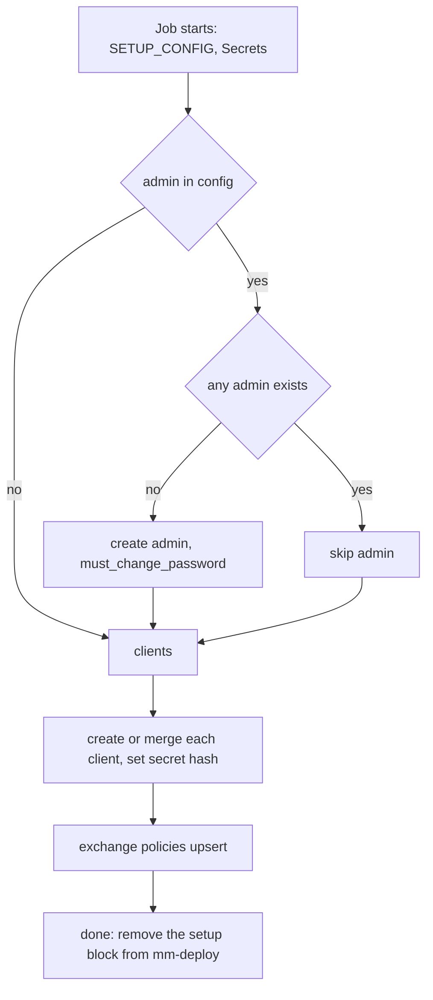

What the Job does not do (use the admin app or the gRPC API): more users, roles and permissions, MFA,
password resets, rotating a client secret, later clients. The admin app cannot add URIs to an
existing client (no update call); to add one, put the `setup:` block back with the new URI.

## 4. Authorization code flow with PKCE (browser login)

This is the main flow. Applications (the gatekeeper, the admin app) send the browser to
`/oauth2/authorize` and later swap the code for tokens.

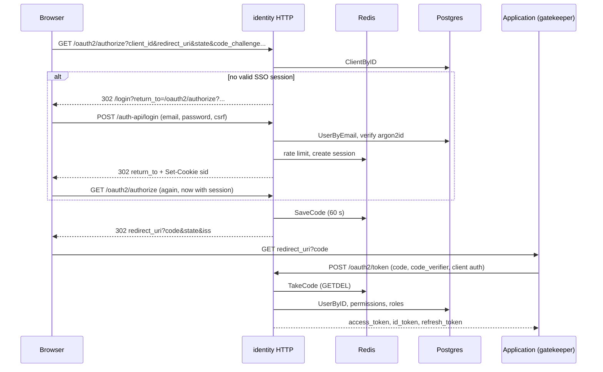

Decision flow inside `authorize` (what the browser sees):

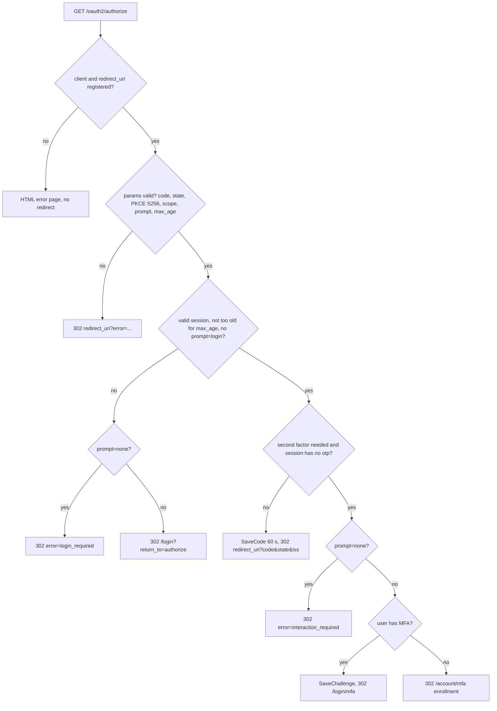

### 4.1 `GET /oauth2/authorize` — `Server.authorize` (`internal/oauth/authorize.go`)

Steps in the function, in order:

1. **Client and redirect URI.** `store.ClientByID`, then `contains(client.RedirectURIs, redirect_uri)`.
   Until both are trusted, errors are shown as an HTML page (`errorPage`), never redirected, so
   identity is not an open redirector.
2. **Parameters.** Checked here, errors go back to the client with `redirectErr`:
   - `response_type=code` only, the client must allow grant `authorization_code`.
   - `state` is required.
   - PKCE is required: `code_challenge_method=S256`, challenge 43 to 128 characters.
   - Every `scope` must be in `client.AllowedScopes` (default `openid`).
   - `prompt` may be `none` or `login`. `max_age` must be a number.
   - `acr_values=mfa` is refused when `MFAMode` is `off`.
3. **Who is signing in.** `sessionFrom` reads the `sid` cookie, `state.GetSession` (slides the idle
   expiry, enforces the absolute one), then `store.UserByID`. A disabled or deleted user ends the
   session. The user must log in when there is no session, `prompt=login`, or the session is
   older than `max_age`. With `prompt=none` this returns `login_required`. Otherwise the
   browser goes to `/login?return_to=...` (the `prompt` is removed so there is no loop).
4. **Second factor.** `account.MFARequirement(user)` and the session `amr`. If a code is
   needed (`!hasAMR(sess.AMR, "otp")`):
   - `prompt=none` returns `interaction_required`.
   - User has MFA: `state.SaveChallenge` then redirect to `/login/mfa?c=<id>` (step-up of the
     existing session, `Challenge.SessionID` is set).
   - User has no MFA yet but must have it: redirect to `/account/mfa?return_to=...` (enrollment).
5. **Issue the code.** `password.Random(32)`, `state.SaveCode` with client, redirect URI, user,
   scope, nonce, PKCE challenge, auth time, `amr`, `acr` and session id. Redirect with
   `code`, `state` and `iss` (RFC 9207).

### 4.2 Login — `apiLogin` (`authapi.go`)

`apiLogin`:

1. `csrfOK` (double submit cookie plus `Origin` check, `server.go`).
2. `account.PasswordLogin` (`internal/account/account.go`):
   - Rate limit with `state.Allow`: 20 per 5 minutes per IP and 5 per 15 minutes per e-mail.
   - Unknown, disabled or password-less user: `password.DummyVerify` so the time is the same as
     for a wrong password. Both return `ErrInvalidCredentials` (the page says "Wrong e-mail or
     password").
   - `password.Verify`, then `state.Reset` of the e-mail counter.
3. The old `sid` session of the browser is ended (`acct.EndSession`): no session fixation.
4. When `user.MustChangePassword` (an admin created by the setup Job, see section 3): no session yet.
   `state.SaveChallenge` with `Purpose = password`, redirect to `/login/password?c=<id>`
   (section 4.4). The steps below run after the new password was set (`continueLogin`).
5. `acct.MFARequirement(user)` decides (`continueLogin`):
   - `Verify`: `state.SaveChallenge` (`amr=[pwd]`, no session yet), redirect to `/login/mfa`.
     The session is created only after both factors.
   - `Enroll`: `startSession` with `amr=[pwd]`, redirect to `/account/mfa?return_to=...`.
   - `NoMFA`: `startSession` with `amr=[pwd]`, redirect to `return_to`.
6. `startSession` creates the Redis session (`state.CreateSession`) and sets the `sid` cookie
   (`HttpOnly`, `SameSite=Lax`, `__Host-` prefix and `Secure` outside local http).

`return_to` is passed through `safeReturn`, which only accepts `/oauth2/authorize?...` and
`/account/mfa`: no open redirect.

Login with password and MFA (user already has MFA):

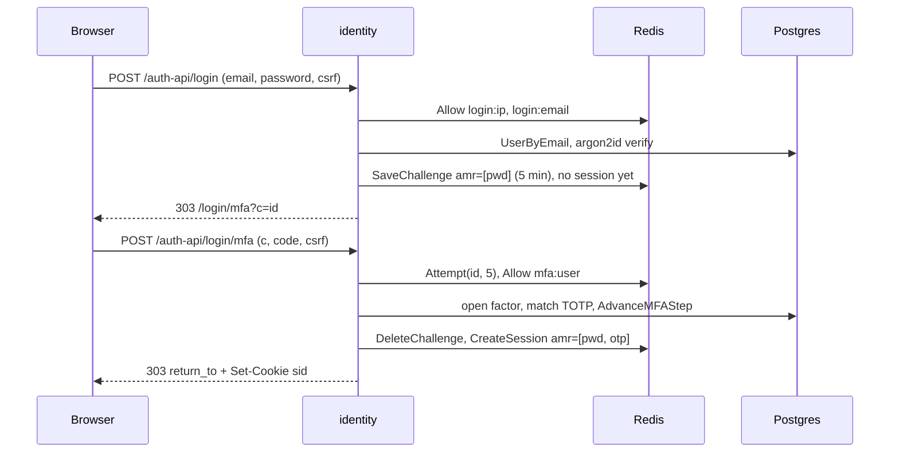

### 4.3 Second factor at login — `apiMFACheck`, `apiMFA`

1. `state.PeekChallenge` to show the form (no attempt counted).
2. `apiMFA`: `csrfOK`, then `state.Attempt(id, 5)`: counts atomically, and after 5 tries
   deletes the challenge (the user must enter the password again).
3. A second limit of 15 attempts per 10 minutes per user (`state.Allow` `mfa:user:<id>`).
4. `account.VerifySecondFactor` (see section 8.3).
5. Success: `state.DeleteChallenge`. If `Challenge.SessionID == ""` it was a login: `startSession`
   with `amr=[pwd, otp]`. Otherwise it was a step-up: `upgradeSession` adds `otp` to the
   existing session (`state.UpdateSession`, TTL kept). Then redirect to `safeReturn(ReturnTo)`.

### 4.5 Passkeys at login — `authapi_passkey.go`

Usernameless sign in (the "Sign in with a passkey" button, or the passkeys in the autofill list of the e-mail field):

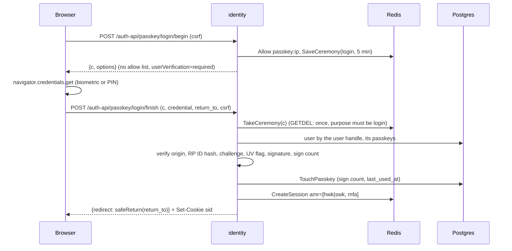

The finish refuses (`401 invalid_passkey`, the reason is only logged): an unknown credential or user handle, a disabled,
deleted or awaiting-approval user, a user who must still change the temporary password, a sign count that did not move
forward (logged as a possible clone), an answer without user verification, a wrong origin or RP ID, and a ceremony of
another purpose or that was used already. A ceremony is consumed by the first answer, right or wrong. The session
starts with `startSession` (same as `apiLogin`: new session, `TouchLogin`), but with the `amr` of the passkey and
without a password or TOTP step.

Passkey as the second factor (`/login/mfa/passkey/begin`, `/finish`): the user signed in with the password, has a passkey
and MFA is required for them (mode `required` or enforced), or a client asked for `acr_values=mfa`. The ceremony id is the id of the MFA challenge, so it is bound to it; `Attempt(c, 5)` and the `mfa:user:`
limiter apply to the finish as to a code, and the end is `finishMFA`, shared with `apiMFA`: `startSession` with
`amr=[pwd, hwk|swk, mfa]` for a login, `upgradeSession` for a step-up. `GET /auth-api/login/mfa` answers
`{totp, passkey}` so the page shows the code field, the passkey button or both.

`mfaDone(amr)` (`otp` or `mfa`) replaces the old `hasAMR(amr, "otp")` in `authorize` (step 4 and the `acr`) and in the
refresh grant, so `acr=mfa` and the step-up work the same for both factors.

### 4.4 Forced password change — `apiPasswordChangeCheck`, `apiPasswordChange` (`authapi.go`)

For a user with `must_change_password` (the admin made by the setup Job). The password the user typed is
temporary: somebody else knows it, so no session, MFA step or authorization code exists until it is replaced.

1. `apiPasswordChangeCheck`: `state.PeekChallenge` must exist and have `Purpose == password` (a second factor
   challenge is not accepted here, and a password challenge is refused by `/login/mfa`).
2. `apiPasswordChange`: `csrfOK`, then `state.Attempt(id, 10)`. The user must still exist, be enabled and have
   the flag. The two fields must be equal.
3. `account.SetPassword(user, new, check=true)`: `password.Check` (policy, not the e-mail, not the same as the
   old one), `store.SetUserPassword` (which also clears `must_change_password`), `RevokeUserAccess`, mail
   "password changed".
4. `state.DeleteChallenge`, reload the user, then `continueLogin` (the MFA requirement, the session, the redirect to
   `return_to`). `authorize` also forces a login for a session whose user still has the flag.

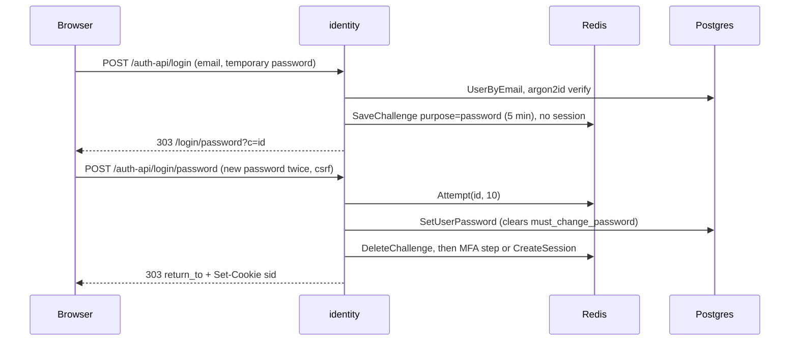

## 5. Token endpoint — `POST /oauth2/token`

`Server.tokenEndpoint` (`internal/oauth/tokens.go`):

1. `authenticateClient`: `client_secret_basic`, `client_secret_post`, or `client_id` alone for a
   public client. The secret is compared in constant time against `Client.SecretHash`. An
   unknown client costs the same work as a real one.
2. The grant must be in `client.AllowedGrants`.
3. Dispatch on `grant_type`:

| `grant_type` | Function | Who uses it |
| --- | --- | --- |
| `authorization_code` | `grantCode` | Browser apps after login |
| `refresh_token` | `grantRefresh` | Browser apps |
| `client_credentials` | `grantClientCredentials` | Services calling services |
| `urn:ietf:params:oauth:grant-type:token-exchange` | `grantExchange` | The gatekeeper |

Errors are `*token.Error` and rendered by `tokenFail` (OAuth JSON). Anything else is logged and
returns `server_error` without details.

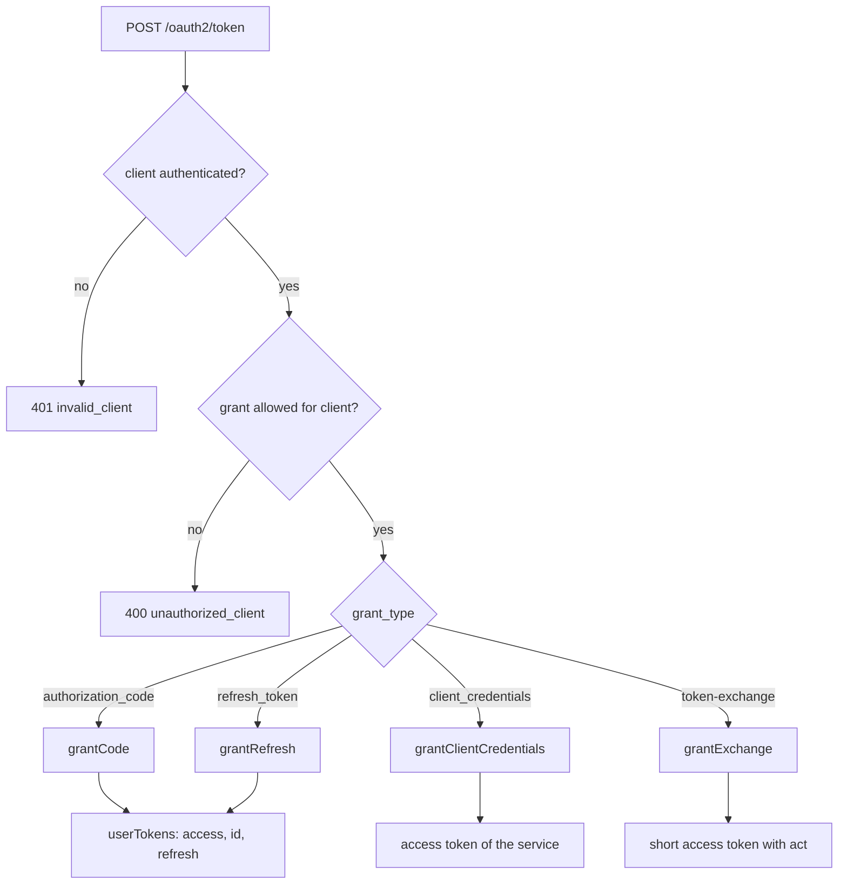

### 5.1 `authorization_code` — `grantCode`

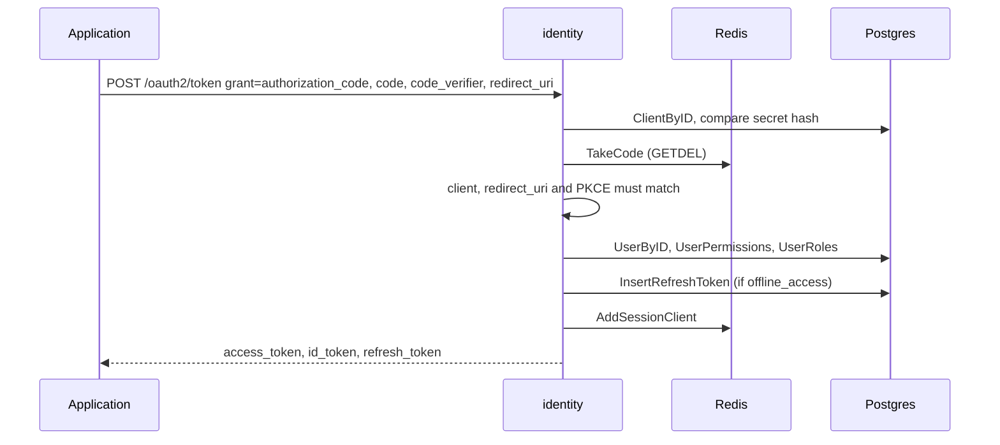

1. `state.TakeCode`: reads and deletes in one step, so a code works once.
2. The code must belong to this client, the same `redirect_uri`, and `pkceOK(code_verifier,
   challenge)` (S256, constant time).
3. The user must still exist and be enabled.
4. `userTokens` (below), then `state.AddSessionClient` so logout knows which clients to notify.

### 5.2 `userTokens` — what is issued

- `store.UserPermissions` and `store.UserRoles` are read from the database now.
- Access token: `token.Service.Access`. Audience is `client.Resource`. Lifetime is the client
  `AccessTokenTTL`, else `IDENTITY_ACCESS_TOKEN_TTL` (10 min). Claims include `sub`, `roles`,
  `perms`, `scope`, `amr`, `acr`, `sid`, `auth_time`.
- ID token (only with scope `openid`): `token.Service.ID`. `name` with scope `profile`, `email`
  with scope `email`, `nonce`, `at_hash`.
- Refresh token (only with `offline_access` and grant `refresh_token`): random 48 bytes,
  stored by digest with `store.InsertRefreshToken` (family, session, scope, `amr`, expiry).

### 5.3 `refresh_token` — `grantRefresh`

1. `store.ConsumeRefreshToken(digest, client)` marks the token used and returns it.
   - A token already used: the whole family is revoked (theft detection) and `ErrRefreshReused`.
   - Unknown, revoked, expired or another client's: `ErrRefreshInvalid`.
   Both are `invalid_grant` to the caller (the reuse is logged as a warning).
2. The user must be active.
3. The scope can only narrow. `acr=mfa` when the original login had `otp`.
4. `userTokens` with the same `familyID`: a new refresh token in the same family. Permissions
   are read again, so a role change applies at the next refresh.

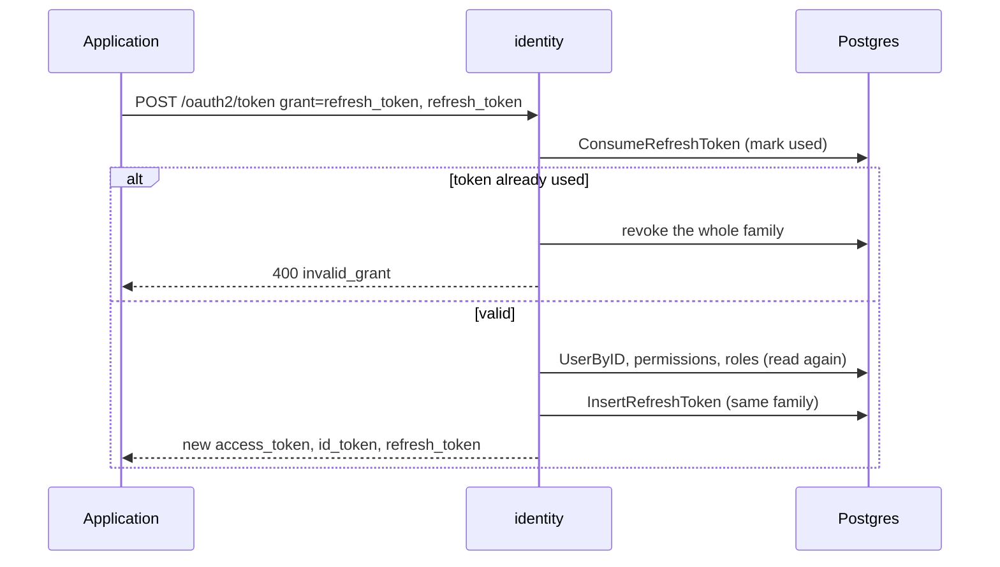

### 5.4 `client_credentials` — `grantClientCredentials`

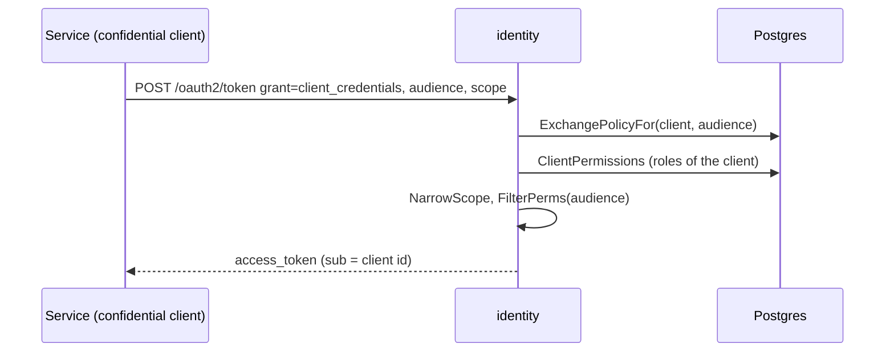

For service to service calls. Confidential clients only.

1. `audience` is required.
2. `store.ExchangePolicyFor(client, audience)` must exist (`access_denied` otherwise).
3. Scope: `token.NarrowScope(requested, client scopes, policy.MaxScope)`.
4. Permissions of the client: `store.ClientPermissions` (from the roles given with
   the admin app or `AssignRole`, or `roles` in the setup config), cut to the audience by `token.FilterPerms`.
5. `token.Service.Access` with `Subject = ClientID`.

### 5.5 Token exchange — `grantExchange` and `token.Service.Exchange`

Used by the gatekeeper to turn the user token (audience = gatekeeper resource) into a short token for one
upstream service (RFC 8693). `Exchange` in `internal/token/token.go`:

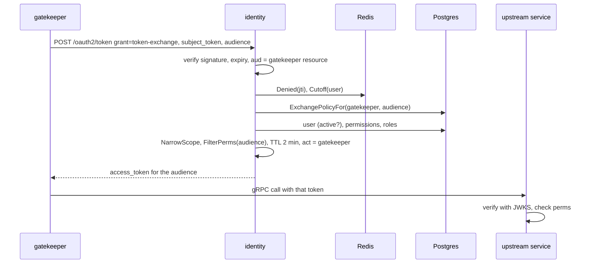

1. Input checks: `subject_token` present, token types are access tokens, exactly one `audience`.
2. `VerifyAccess(subject_token, caller.Resource)`: our signature, expiry, audience equals the
   caller's resource, not on the denylist, not before the user's cutoff (`checkLive`).
3. `store.ExchangePolicyFor(caller, audience)` must exist. The delegation depth
   (`Act.Depth()+1`) must not pass `MaxChainDepth`.
4. Subject is a user (user must be active, permissions and roles re-read from the database) or
   a service (a `client_credentials` token forwarded by the gatekeeper: the permissions of its
   roles).
5. Scope narrows with `NarrowScope` (token scope and policy max). Permissions are cut with
   `FilterPerms` so a service never sees the permissions of another one.
6. Lifetime: `IDENTITY_EXCHANGE_TOKEN_TTL` (2 min), never longer than what is left of the
   subject token.
7. New access token with `act = {sub: caller}` (and the previous `act` chain). The log line has
   `sub`, `act`, `audience`, `scope`, `subject_jti`, `jti`.

## 6. Other token endpoints

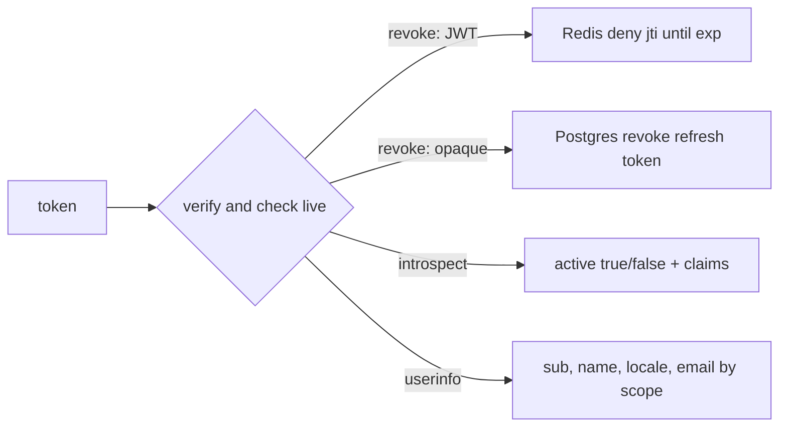

### 6.1 `POST /oauth2/revoke` — `revoke` (RFC 7009)

Client authenticated. Always answers 200 (no oracle on the token).
- JWT (two dots): `tokens.VerifyAny`, and if it belongs to the client, `state.Deny(jti, remaining life)`.
- Anything else is a refresh token: `store.RevokeRefreshByHash`.

### 6.2 `POST /oauth2/introspect` — `introspect` (RFC 7662)

Confidential clients only. `VerifyAny`, type must be `access`, then `tokens.IsLive`
(denylist and cutoff). Returns `active`, `sub`, `client_id`, `scope`, `aud`, `jti`, `exp`, `iat`,
`iss` and the `act` chain. The gRPC `Introspect` (section 9) does the same.

### 6.3 `GET/POST /userinfo` — `userinfo`

Bearer access token with scope `openid`, live, and for a user (not a service). Returns `sub`,
plus `name`, `locale` (scope `profile`) and `email` (scope `email`).

### 6.4 Discovery and keys — `discovery`, `jwks`

Static documents cached 5 minutes. `jwks` serves `keys.Set.JWKS` (current plus retired keys).
Services verify tokens locally with these keys (`gocommon/jwtx`).

## 7. Logout

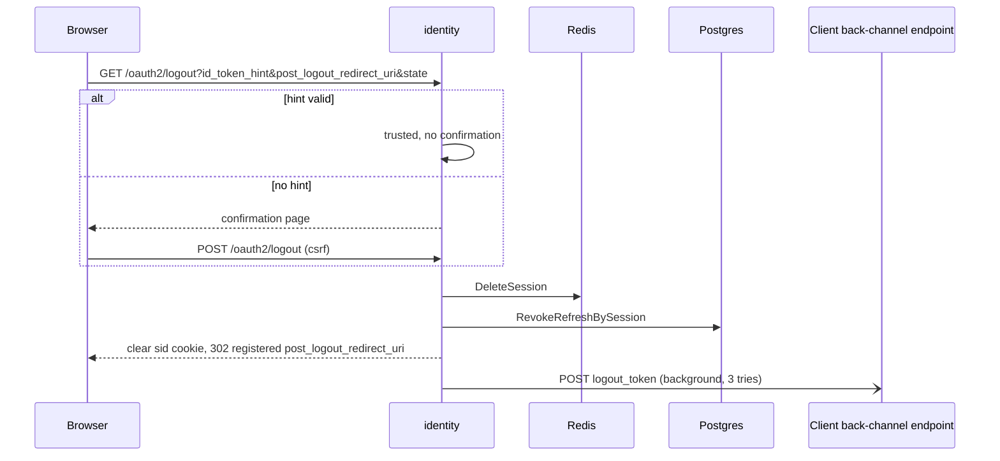

### 7.1 RP initiated logout — `endSession` (`logout.go`)

`GET` or `POST /oauth2/logout`.

1. With `id_token_hint`: `tokens.VerifyIDHint` (an expired one is fine up to the refresh
   token lifetime, a forged one is not). The client is the `aud`. This is trusted: logout
   happens at once.
2. Without a hint: a confirmation page with a POST form (`confirm-logout`), and the POST needs
   `csrfOK`. This stops another site from signing people out with an image tag.
3. `post_logout_redirect_uri` is used only if it is registered for the client.
4. `account.EndSession(publicID)`, the `sid` cookie is cleared.

### 7.2 `account.EndSession` and back-channel logout

`internal/account/account.go`:

1. `state.DeleteSession` (removes the session and returns it).
2. `store.RevokeRefreshBySession` revokes the refresh tokens of that session.
3. `backchannel(session)`: for each client in `Session.Clients` that has a
   `BackchannelLogoutURI`, a background task signs a logout token (`token.Service.Logout`, 2 min,
   event `backchannel-logout`) and POSTs it (`postLogout`), 3 attempts with growing delay.
   Failures are logged, never fatal.

### 7.3 `account.RevokeUserAccess` — end everything for a user

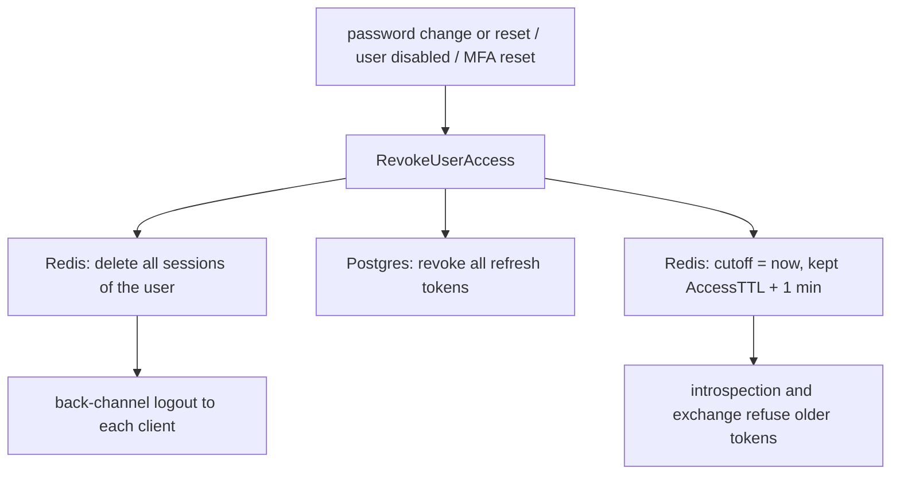

Used by password change, reset, disabling a user and MFA reset.
1. `state.DeleteUserSessions` (and back-channel logout for each).
2. `store.RevokeRefreshByUser`.
3. `state.SetCutoff(user, now, AccessTTL + 1 min)`: access tokens issued before this moment are
   refused by introspection and token exchange. Services that verify locally stop accepting
   them when the token expires (at most the access token lifetime).

### 7.4 Sessions of a device — `account/sessions.go`

`startSession` (`oauth/authorize.go`, the one place every sign in creates a session) stores `IP` (`c.ClientIP()`),
`UserAgent` (512 bytes at most) and `LastSeen`. `state.GetSession` rewrites `LastSeen` when it is older than a minute
(`SET XX KEEPTTL`).

- `state.ListUserSessions`: `SMEMBERS identity:usess:<uid>`, then `sidx` and the session of each; a member whose session
  expired idle is `SREM`-ed (idle expiry never cleans the set).
- `account.ListSessions` / `EndUserSession(uid, pid)` (checks `IsUserSession`, else `ErrSessionNotFound`, then `EndSession`)
  / `EndOtherSessions(uid, keep)` (one `EndSession` each).
- `service/sessions.go`: `ListMySessions`, `RevokeMySession`, `RevokeMyOtherSessions` take the user from the token and mark
  `current` with `Principal.SessionID`; `ListUserSessions` and `RevokeUserSessions` (which is `RevokeUserAccess`, 7.3) are
  the administrator's.

An access token already issued is not recalled by ending one session (see `README.md`, "Active sessions").

## 8. Account flows (HTML pages)

### 8.1 Password reset

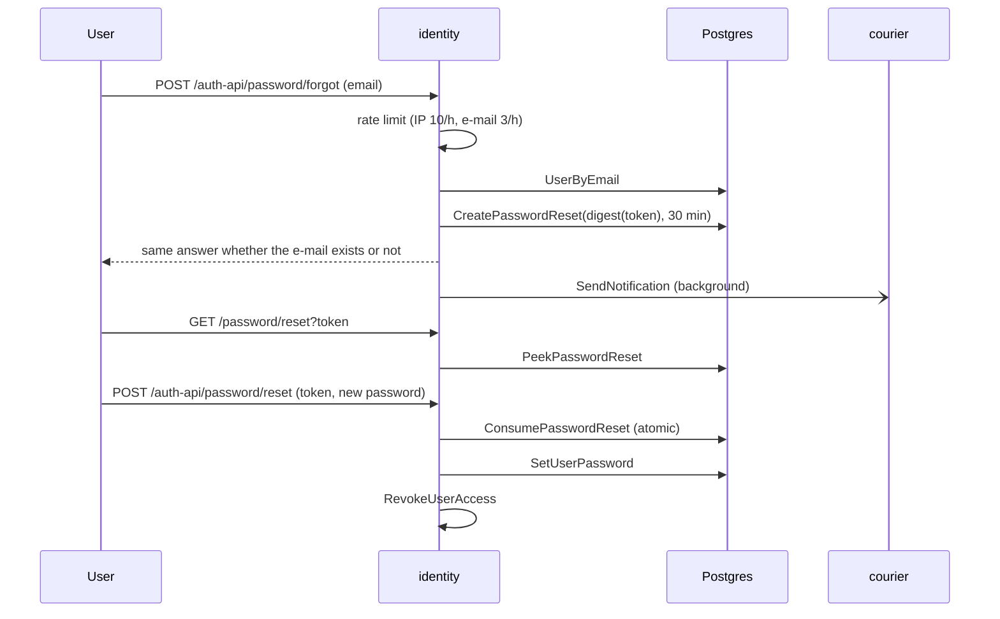

- `apiForgot` calls `account.RequestReset`: rate limits per IP and per e-mail (over the limit
  it still answers the same), unknown or disabled users return `nil`, so the answer never
  reveals whether the address exists. The mail is sent in the background (`Service.background`) so the
  response time does not depend on the outcome.
- `apiResetCheck` calls `account.ResetTokenUser` (peek only).
- `apiReset` calls `account.CompleteReset`: the password policy (`password.Check`: length,
  common passwords, not the e-mail, not the same) runs before the token is consumed;
  `store.ConsumePasswordReset` is atomic, so two requests with one token cannot both win; then
  `SetPassword` stores the hash, calls `RevokeUserAccess` and mails "password changed".

### 8.2 MFA enrollment and management (`/account/mfa`)

All handlers return 404 when `IDENTITY_MFA_MODE=off` and need a session (`requireSession`, which
sends the browser to `/login`).

| Step | Handler | Account method |
| --- | --- | --- |
| Show QR code or status | `accountMFA` → `mfaPage` | `BeginEnrollment` (reuses a pending secret, so a reload keeps the QR code) |
| Confirm the first code | `accountMFAConfirm` | `ConfirmEnrollment` |
| Turn off | `accountMFADisable` | `DisableMFA` |

- `BeginEnrollment`: new TOTP secret (`mfa.NewSecret`), sealed with `Sealer.Seal(secret, userID)`,
  stored with `store.ReplaceMFAFactor` (unconfirmed). Returns the base32 secret, the
  `otpauth://` URI and a PNG QR as a data URI.
- `ConfirmEnrollment`: limit 10 per 10 minutes, `mfa.Match` on the first code, then 10 recovery
  codes (`mfa.RecoveryCodes`, stored as digests) and `store.ConfirmMFAFactor`. The page
  shows the codes once and `upgradeSession` marks the session as multi-factor. A mail tells the user.
- `DisableMFA`: refused when MFA is required (`MFAForced`: mode `required` or the user is
  enforced). Otherwise it needs the password and a code, then `AdminDisableMFA` (`store.ResetMFA`).
- `RegenerateRecoveryCodes` (`POST /api/me/mfa/recovery-codes` of the portal): refused when MFA is off (`ErrMFANotEnrolled`).
  It needs the password and a code of the authenticator app (`verifyTOTP`; a recovery code is not accepted, it would be
  spent just before it is replaced), limited to 10 per 10 minutes per user. It replaces the 10 codes in one transaction
  (`store.ReplaceRecoveryCodes`), returns the new ones once and mails `recovery_regenerated`.

MFA enrollment:

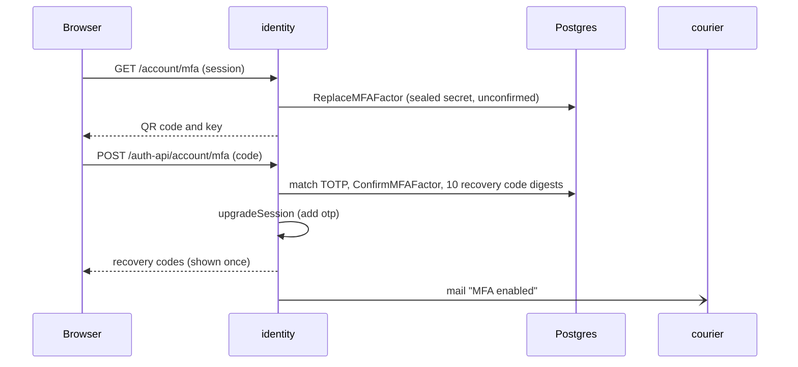

### 8.3 Checking a second factor — `account.VerifySecondFactor`

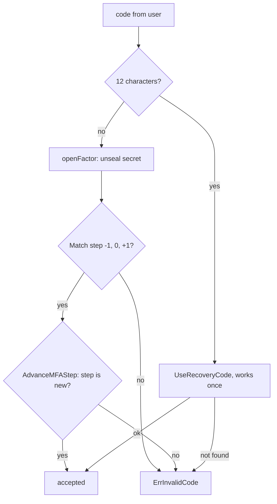

- A 12 character input is treated as a recovery code (`mfa.NormalizeRecoveryCode`) and consumed
  with `store.UseRecoveryCode` (works once).
- Otherwise: `openFactor` (unseals the secret; `Sealer.NeedsReseal` re-encrypts with the newest
  key), `mfa.Match` accepts the previous, current and next 30 second step (clock drift), and
  `store.AdvanceMFAStep` accepts a step only once (a code cannot be replayed).

### 8.4 MFA mode matrix — `account.MFARequirement`

| `IDENTITY_MFA_MODE` | User has MFA | User is enforced | Result at login |
| --- | --- | --- | --- |
| `off` | any | any | `NoMFA` |
| any other | TOTP | any | `Verify` |
| `required` | no TOTP, has a passkey | any | `Verify` (the passkey) |
| `required` | none | any | `Enroll` |
| `optional` | no TOTP, has a passkey | yes | `Verify` (the passkey) |
| `optional` | none | yes | `Enroll` |
| `optional` | no TOTP | no | `NoMFA` (a passkey is not asked for) |

A passkey is a second factor only when MFA is required; otherwise it is a way in of its own, and a password sign in stays
a password sign in. A passkey login needs no step at all: its session already has `mfa` in the `amr`. `authorize` with
`acr_values=mfa` asks a user who has a TOTP device or a passkey for it (`MFAMethods`), others are sent to enroll.

A client can also ask for MFA with `acr_values=mfa`; `authorize` then asks for the code if the
session has neither `otp` nor `mfa` (a passkey) in its `amr`.

### 8.5 Passkeys of the signed in user — `account/passkeys.go`

`GET /auth-api/account/passkeys` lists them. `POST .../begin` takes the **current password** (`checkPassword`: 5 failures
per 15 minutes per user, like `DisableMFA`) and returns `{c, options}` for `navigator.credentials.create` (resident key
and user verification required, no attestation, the passkeys the user has excluded); `POST .../finish {c, credential, name}`
consumes the ceremony (purpose `register`, bound to the user), verifies the credential, stores it (the credential id is
unique across users) and mails `passkey_added`. At most 20 per user. `PATCH .../{id}` renames; `DELETE .../{id}` needs the
password again and mails `passkey_removed`. The portal does the same through gRPC (`ListMyPasskeys`, `BeginMyPasskey`,
`FinishMyPasskey`, `RenameMyPasskey`, `DeleteMyPasskey`); the browser runs the ceremony on the portal's origin, which must be
in `IDENTITY_WEBAUTHN_ORIGINS` and covered by the RP ID. `AdminResetMFA` deletes the passkeys with the TOTP factor.

## 9. gRPC administration API — `internal/service/service.go`

Auth: `grpcserver.JWTAuth` (our own JWT with audience `identity`). Authorization:
`grpcserver.WithMethodPermissions(service.Permissions)`: every RPC needs the permission listed in the
`Permissions` map, and an RPC without an entry is denied. Domain errors are mapped by `toErr`
(`store.ErrNotFound` → NotFound, `ErrConflict` → AlreadyExists, password policy → InvalidArgument,
anything else → Internal without details).

| RPC | Permission | Handler logic |
| --- | --- | --- |
| `Introspect` | `identity:token:read` | `VerifyAny` + `IsLive` |
| `CheckPermission` | `identity:permission:read` | `store.UserPermissions` + `authz.Allowed` (disabled user: not allowed) |
| `RevokeToken` | `identity:token:write` | `state.Deny(jti, ttl)` |
| `GetUser`, `ListUsers` | `identity:user:read` | `ListUsers` pages by e-mail (page token = base64 of last e-mail, size 50, max 200) |
| `CreateUser` | `identity:user:write` | e-mail checks, `password.Check` and `Hash`, `store.CreateUser` |
| `SetUserDisabled` | `identity:user:write` | disabling also calls `RevokeUserAccess` |
| `SetUserPassword` | `identity:user:write` | `account.SetPassword(check=true)` |
| `SendPasswordReset` | `identity:user:write` | `account.SendReset` |
| `UpdateUser` | `identity:user:write` | name, locale (`en`, `vi`) and theme (`light`, `dark`, `system`; `identity_users.theme`, V12) |
| `SetUserAvatar` | `identity:user:write` | png/jpeg/webp, at most 64 KiB and 512x512, stored as `bytea`; `GetUser` returns it as a data URI |
| `ListPermissions` | `identity:permission:read` | the catalog of permissions, with how many roles hold each; paged by token (see below) |
| `ListPermissions` | `identity:permission:read` | the catalog (read only) plus the generated wildcards; services declare permissions in code and identity saves them at start |
| `RegisterPermissions` | `identity:permission:register` | a service syncs its permissions at start (namespace of its client's `resource` only); a removed permission that a role holds is retired, never cascaded |
| `GetUserStats` | `identity:user:read` | counts by status, plus `created_this_month` (UTC) (active/pending/disabled), MFA, avatar, activity |
| `GetMe`, `UpdateMe`, `SetMyAvatar`, `ChangeMyPassword`, `GetMyMFA`, `BeginMyMFA`, `ConfirmMyMFA`, `DisableMyMFA`, `RegenerateMyRecoveryCodes` | any user token (`grpcserver.Public`) | the user is the token subject (`meID`), never a request field; service tokens are refused; `UpdateMe` keeps empty fields; `ChangeMyPassword` checks the current password (limited to 5 failures per 15 minutes per user), applies the policy and, like `SetUserPassword`, ends every session and token of the user, the caller's too; the MFA methods call `BeginEnrollment`, `ConfirmEnrollment`, `DisableMFA` and `RegenerateRecoveryCodes` of `account` (the same steps and limits as the account page of the sign in app; `BeginMyMFA` creates the pending enrollment of a user who has none; `GetMyMFA` only reads the status) |
| `SendWelcome` | `identity:user:write` | `account.SendWelcome`: set-password link valid 7 days, only while the user has no password |
| `CreateRole`, `SetRolePermissions`, `AssignRole`, `RevokeRole` | `identity:role:write` | `authz.Valid` on each permission; roles go to a user **or** a client |
| `UpdateRole` | `identity:role:write` | replaces description and permissions of a role in one transaction |
| `DeleteRole` | `identity:role:write` | refused (`FAILED_PRECONDITION`) while a user or a client holds the role; the role row is locked while counting |
| `ListRoles` | `identity:role:read` | each role has `assigned_count` (users + clients); paged by token (see below) |
| `CreateClient`, `RotateClientSecret` | `identity:client:write` | validates grants and URIs; a public client cannot use `client_credentials` or exchange; the secret is returned once |
| `UpdateClient` | `identity:client:write` | replaces name, URIs, grants, scopes, resource and roles; the id and type are fixed, the grant rules of the stored type apply |
| `SetClientDisabled` | `identity:client:write` | a disabled client cannot start a sign in or get tokens; the client of the caller's own session cannot be disabled |
| `DeleteClient` | `identity:client:write` | only a disabled client, never the client of the caller's own session; roles and exchange policies cascade |
| `ListClients` | `identity:client:read` | each client has `disabled`; paged by token (see below) |
| `SetExchangePolicy` | `identity:exchange:write` | `max_chain_depth` 1 to 5; `delete` removes the policy |
| `ListExchangePolicies` | `identity:exchange:read` | filters `client_id` (exact), `query` (client, audience or scope contains) and `audience` (contains), case insensitive, combined with AND; paged by token (see below) |
| `GetUserMFA` | `identity:mfa:read` | |
| `SetUserMFA`, `EnforceUserMFA`, `ResetUserMFA` | `identity:mfa:write` | Admin methods of `account` (turn off, enforce, reset and end sessions) |

Pagination: `ListUsers`, `ListRoles`, `ListPermissions`, `ListClients` and `ListExchangePolicies` take `page_size` (default 50, at most 200) and `page_token`, and answer `next_page_token` (empty on the last page). The token is opaque (base64url of the sort key of the last item: email, role name, permission name, client id, or client id and audience) and the query is keyset (`key > last`), not offset, so pages stay stable while rows are added or removed. An invalid token is `InvalidArgument`. The admin pages show 25 per page with a Load more button; the pickers (role cards, permission picker, client suggestions) read every page.

Note: there is no RPC to add a redirect URI to a client. That is only the setup Job (`redirect_uris` and `post_logout_uris` in `SETUP_CONFIG`, merged into the stored lists).

## 10. The gatekeeper (BFF) end to end

The gatekeeper is the only public entry point of the platform for browsers, mobile apps and
services. It is a pure JSON to gRPC mapper plus the OIDC login. The browser never sees a token:
it only holds an opaque `HttpOnly` session cookie. Code is in `../gatekeeper` (module
`github.com/huponx/gatekeeper`).

### 10.1 Map of the gatekeeper code

| File | Role |
| --- | --- |
| `cmd/gatekeeper/main.go` | Wiring: routes, Redis, session store, OIDC discovery, JWKS verifier, token exchange client, gRPC proxy, HTTP server. |
| `internal/routes/routes.go` | Loads and validates `routes.yaml` (`routes.Parse`). |
| `internal/bff/bff.go` | HTTP handlers: `/auth/*` and every configured route (`Server.route`). |
| `internal/session/session.go` | Sessions in Redis, tokens sealed with AES-GCM, login state, refresh lock, back-channel indexes. |
| `internal/proxy/proxy.go` | JSON to gRPC call without generated stubs (descriptor set or reflection). |
| `internal/appconfig/appconfig.go` | `GATEKEEPER_*` environment variables. |
| `gocommon/oidcclient` | Relying party: `AuthURL` (PKCE), `Exchange`, `Refresh`, `Revoke`, `EndSessionURL`, `VerifyLogoutToken`. |
| `gocommon/tokenexchange` | `ExchangeToken` (RFC 8693) and `ServiceToken` (client credentials), both cached. |
| `gocommon/authn` | `Verify` (access token to `Principal`), `Principal.Can(permission)`. |

Fixed endpoints, registered in `bff.Server.Routes`:

| Endpoint | Handler | Purpose |
| --- | --- | --- |
| `GET /auth/login` | `login` | Start the OIDC code flow |
| `GET /auth/callback` | `callback` | Finish it and create the session |
| `GET /auth/me` | `me` | Who am I (sub, roles, scopes, perms, amr, `csrf_token`, expiry) |
| `POST /auth/logout` | `logout` | End session, revoke refresh token, return the identity logout URL |
| `POST /auth/backchannel-logout` | `backchannelLogout` | Receives the logout token from identity |
| `GET /healthz`, `/readyz` | `healthz` | Liveness, readiness (Redis) |
| any route of `routes.yaml` | `route` | JSON to gRPC |

`/auth/*`, `/healthz` and `/readyz` are reserved: a route in `routes.yaml` cannot use them.

### 10.2 Startup — `cmd/gatekeeper/main.go`

1. `routes.Load(GATEKEEPER_ROUTES_FILE)`: rejects unknown fields, unknown upstreams, duplicate
   routes, bad methods, reserved paths. A route needs `permission` or `public: true`, never both
   (deny by default).
2. Redis and `session.New` with `GATEKEEPER_SESSION_KEY` (first key seals, the others only open).
3. `oidcclient.Discover(GATEKEEPER_IDENTITY_ISSUER)` with `GATEKEEPER_CLIENT_ID` and
   `GATEKEEPER_CLIENT_SECRET`. The redirect URL is `GATEKEEPER_PUBLIC_URL/auth/callback` and must be
   registered on the identity client (`redirect_uris` in the setup config).
4. `jwtx.NewRemoteKeySet` on the identity `jwks_uri` and a `Verifier` for issuer and
   `GATEKEEPER_AUDIENCE` (this must equal the `resource` of the gatekeeper client in identity).
5. `tokenexchange.New` on the identity `token_endpoint`.
6. `proxy.New` and `proxy.Check`: with a descriptor set a typo is a start-up error, with reflection it
   only warns (the upstream may not be up yet).
7. HTTP server: `bff.Server.Routes`.

### 10.3 Login — `login` and `callback`

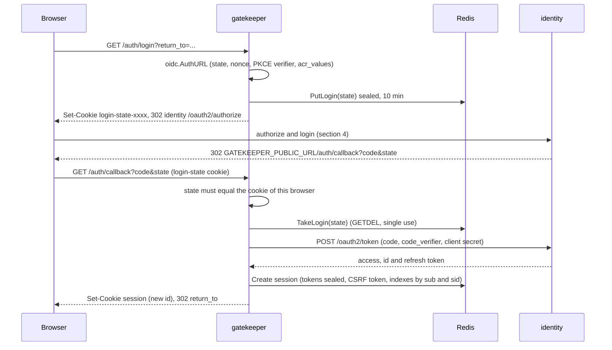

- `login`: `return_to` goes through `safeReturn` (a path of this site, or an absolute URL on one
  of `GATEKEEPER_UI_ORIGINS`), otherwise `GATEKEEPER_POST_LOGIN_URL`. Every attempt has its own
  cookie `login-state-<hash>` (several tabs do not overwrite each other). `GATEKEEPER_ACR_VALUES=mfa`
  asks identity for a second factor on every login.
- `callback`: an `error` from identity gives 401 `login_failed`. The ID token is verified by
  `oidcclient.Exchange` (nonce included). A token without `sub` is refused.
- The session is created by `session.Store.Create`: new random id at every login (no session
  fixation), CSRF token of 24 random bytes, sets `gk:sid:<identity sid>` and `gk:sub:<sub>`
  for back-channel logout.
- Cookie name is `__Host-session` outside local http (`Secure`, `HttpOnly`, `SameSite=Lax`).

### 10.4 Authenticating a request — `authenticate`

Two modes, chosen by the request:

| Mode | When | What happens |
| --- | --- | --- |
| Session cookie | no `Authorization` header (browser) | Loads the session, refreshes the tokens if they expire in less than 30 s, verifies the access token. |
| Bearer | any `Authorization` header (mobile app, service) | `authenticateBearer` verifies the token locally. No session is stored. A malformed header is 401, never a fallback to the cookie. |

Cookie mode, in order:

1. No cookie or session not found: 401 `unauthenticated` (cookie cleared).
2. `session.Store.Get` slides the idle timeout, never beyond the absolute lifetime (`GATEKEEPER_SESSION_IDLE_TTL` 8 h, `GATEKEEPER_SESSION_ABSOLUTE_TTL` 168 h).
3. Token near expiry: `refresh` (below).
4. `authn.Verify(access token)`: signature (JWKS), issuer, audience, expiry and type. An invalid token
   deletes the session (key rotated away, user revoked). If the JWKS cannot be loaded it is 503, not a logout.
5. The `Principal` (sub, roles, scopes, perms, amr) is put on the request context.

A revoked token still verifies locally until it expires, so keep the access token lifetime short
(`IDENTITY_ACCESS_TOKEN_TTL`, 10 min). Disabling a user ends the identity session and refresh
tokens at once, and the gatekeeper session ends at the next refresh or through back-channel logout.

### 10.5 Refresh — `refresh`

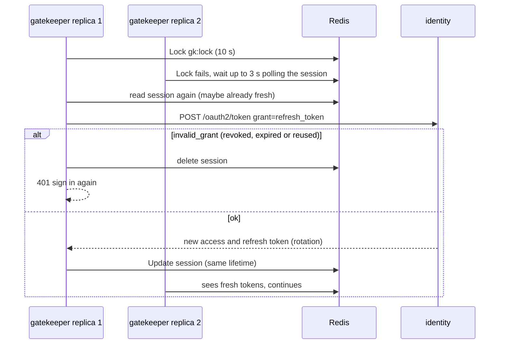

Only one replica refreshes, because two replicas using the same refresh token would trigger the
reuse detection of identity (`store.ConsumeRefreshToken`) and revoke the whole family.

### 10.6 A routed call — `Server.route`

For each entry of `routes.yaml`, in this order:

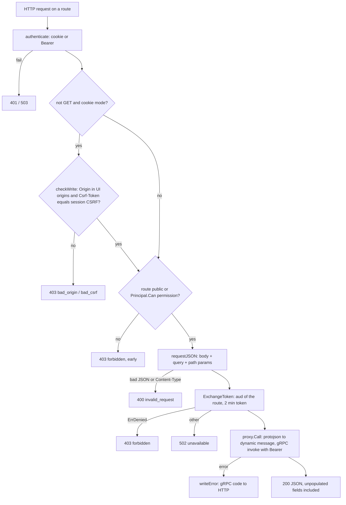

- `requestJSON`: the JSON object body (only for non-GET, `Content-Type: application/json`, max 1 MiB),
  then the query string (a repeated key becomes an array), then the path parameters. Path parameters
  win, so `{user_id}` always fills `user_id`. The result is unmarshalled by `protojson` into the
  request message of the method, so an unknown field is a 400.
- `ExchangeToken(session access token, route audience)`: the audience defaults to the upstream name. The
  result is cached by `tokenexchange` per (subject token, audience, scope) until shortly before it expires.
  Identity enforces the policy (section 5.5).
- `proxy.Call`: `resolve` finds the method (descriptor set, or gRPC reflection with a service token
  `exch.ServiceToken(audience)`, cached 10 minutes), `dynamicpb` builds the messages, the call carries
  `authorization: Bearer <exchanged token>`. Streaming methods are refused.
- The upstream checks the token again. For identity that is `grpcserver.JWTAuth` and then the
  permission of the method in `service.Permissions` (section 9). The permission in `routes.yaml`
  must be the same one, so the early 403 never disagrees with the upstream.

Error mapping — `writeError` and `mapCode`:

| gRPC code | HTTP | `error.code` |
| --- | --- | --- |
| InvalidArgument, OutOfRange | 400 | `invalid_argument` |
| NotFound | 404 | `not_found` |
| AlreadyExists, Aborted | 409 | `conflict` |
| FailedPrecondition | 412 | `failed_precondition` |
| PermissionDenied | 403 | `forbidden` |
| Unauthenticated | 502 | `upstream_auth` (the gatekeeper's own token was refused, not the user's fault) |
| ResourceExhausted | 429 | `rate_limited` |
| Unavailable | 503 | `unavailable` |
| DeadlineExceeded | 504 | `timeout` |
| Unimplemented | 501 | `unimplemented` |
| other | 500 | `internal` |

For 5xx the message is replaced by "the service failed to process the request" (details only in the log).
All errors have the form `{"error": {"code": "...", "message": "..."}}`.

### 10.7 Logout

```mermaid
sequenceDiagram
    participant B as Browser
    participant G as gatekeeper
    participant R as Redis
    participant I as identity

    B->>G: POST /auth/logout?return_to=https://app/ (Origin, Csrf-Token)
    G->>G: checkWrite
    G->>R: delete session
    G->>I: POST /oauth2/revoke (refresh token)
    G-->>B: {"logout_url": identity /oauth2/logout?id_token_hint&post_logout_redirect_uri}
    B->>I: GET logout_url
    I->>I: EndSession (section 7)
    I-)G: POST /auth/backchannel-logout (logout_token)
    G->>G: VerifyLogoutToken
    G->>R: delete sessions of that sid (or of the sub)
    I-->>B: 302 registered post_logout_redirect_uri
```

- `logout` without a valid session still returns 200 with the logout URL (idempotent).
- `return_to` must be a UI origin and also registered as a post-logout URI of the client in identity.
- `backchannelLogout` is called by identity (`account.backchannel`): `DeleteByIDPSession(sid)` when the
  token has `sid`, otherwise `DeleteBySubject(sub)`. The client in identity needs
  `backchannel_logout_uri = <public url>/auth/backchannel-logout`. This is how a logout in
  one application, a password reset or a disabled user ends the gatekeeper sessions right away.

### 10.8 CORS and origins

`bff.Server.cors` answers only the browsers of `GATEKEEPER_UI_ORIGINS` (credentials allowed, never
`*`), and answers preflights before authentication. With no UI origins configured only the gateway
origin itself is accepted. The same list is used for `checkWrite` and `safeReturn`.

### 10.9 Whole picture

```mermaid
sequenceDiagram
    participant B as Browser (admin app)
    participant G as gatekeeper
    participant R as Redis (gatekeeper)
    participant I as identity
    participant S as upstream service (gRPC)

    B->>G: GET /api/users (cookie)
    G->>R: load session, refresh if needed
    G->>G: verify access token with JWKS, Principal.Can("identity:user:read")
    G->>I: token exchange (aud identity), cached
    I-->>G: 2 minute token with act = gatekeeper
    G->>S: ListUsers(JSON turned into protobuf) + Bearer
    S->>S: verify JWT, service.Permissions check, handler
    S-->>G: protobuf reply
    G-->>B: 200 JSON
```

When the upstream is another service than identity (for example courier), the same steps apply:
add an upstream, routes and an exchange policy (an exchange policy `gatekeeper -> <aud>`, in the admin app or `exchange_policies` of the setup config). A call that needs several gRPC methods belongs in one method of a service, not in the gatekeeper.

## 11. Security properties and where they are enforced

| Property | Where |
| --- | --- |
| No open redirect | `authorize` (redirect URI must be registered), `safeReturn`, `endSession` (registered logout URIs) |
| PKCE S256 required | `authorize`, `pkceOK` |
| Code works once, 60 s | `state.TakeCode` (GETDEL), `codeTTL` |
| CSRF on forms | `csrfOK`: double submit cookie + `Origin` |
| No session fixation | `apiLogin` ends the old session |
| No user enumeration | `DummyVerify`, same message, `RequestReset` answers the same |
| Brute force limits | `state.Allow` (login, reset, MFA confirm, MFA disable, MFA user), `state.Attempt` (5 per challenge) |
| TOTP replay | `store.AdvanceMFAStep` |
| Refresh token theft | `store.ConsumeRefreshToken` revokes the family on reuse |
| Immediate revocation | denylist (`state.Deny`) and cutoff (`state.SetCutoff`), checked by `checkLive` |
| Least privilege on exchange | `ExchangePolicyFor`, `NarrowScope`, `FilterPerms`, 2 minute TTL, `act` claim |
| Secrets at rest | hashes for passwords, secrets, tokens; AES-GCM for TOTP |
| Key rotation | `keys.Load` keeps retired keys in the JWKS; `Sealer` re-seals on read |
| Browser never holds a token | gatekeeper `session.Store`: opaque cookie, tokens sealed with AES-GCM in Redis |
| CSRF on JSON calls | gatekeeper `checkWrite`: `Origin` in UI origins and `Csrf-Token` equals the session token (cookie mode only) |
| Early deny | gatekeeper `Principal.Can(route.Permission)`; identity checks again with `service.Permissions` |
| One refresh at a time | gatekeeper `session.Store.Lock`, so refresh token reuse detection is not triggered |
| Sessions end on logout events | gatekeeper `backchannelLogout` with the indexes `gk:sid:` and `gk:sub:` |

## Registration

`POST /auth-api/register` (only with `IDENTITY_REGISTRATION_ENABLED`; off answers 404) creates a user without a password.
The system setting `registration_requires_approval` (table `identity_system_settings`; Admin → System settings →
Registration, RPCs `Get/SetRegistrationSettings`; default **true** when no row exists) decides what happens next:

- **Off:** `SendWelcome` mails the set-password link at once; the user sets a password and is active.
- **On:** the user is stored with `pending_approval = true` (status `USER_STATUS_PENDING_APPROVAL`, filter
  `awaiting_approval` in the Users list). No link is sent. The applicant gets `identity_registration_received`; every
  non-disabled user whose roles hold `identity:user:approve` (the `admin` role through `*`, and `user_approver`) gets
  `identity_registration_pending` (applicant name and e-mail, a link to `IDENTITY_ADMIN_URL` when set).
  - **Approve** (`ApproveUser`, `POST /api/users/{id}/approve`): `ApproveRegistration` clears the flag and calls
    `SendWelcome` (`identity_welcome`, the set-password link); the user sets a password. Status then follows the usual
    rule (pending until the password is set, then active).
  - **Reject** (`RejectUser`, `POST /api/users/{id}/reject`): `RejectRegistration` soft-deletes the user (the e-mail is
    freed, so the address can register again) and mails `identity_registration_rejected`.

A welcome link is a reset token, so the approval state also blocks the other ways to a password: `RequestReset` (forgot
password) sends nothing to a user awaiting approval, `ResetTokenUser`/`CompleteReset` treat a token of such a user as
invalid, and `SendWelcome`/`SendReset` (admin API) fail with reason `awaiting_approval`. Only approval lifts it.

**Roles.** `user_approver` (migration V37) holds `identity:user:approve` and `identity:user:read` only: it opens the Users
page read-only, sees who waits, and approves or rejects; it cannot edit users or settings. The setting itself needs
`identity:settings:read` / `identity:settings:write`. Locally courier writes all of these mails to `.local/mails/`.
