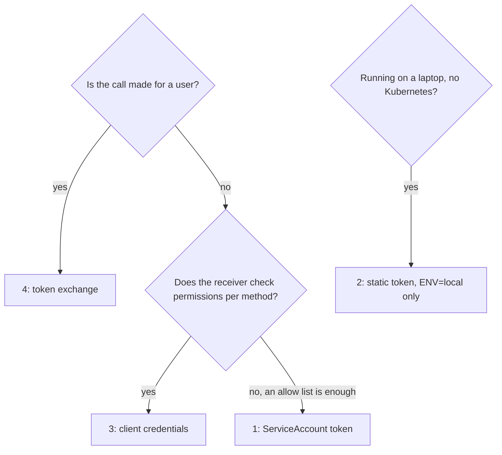
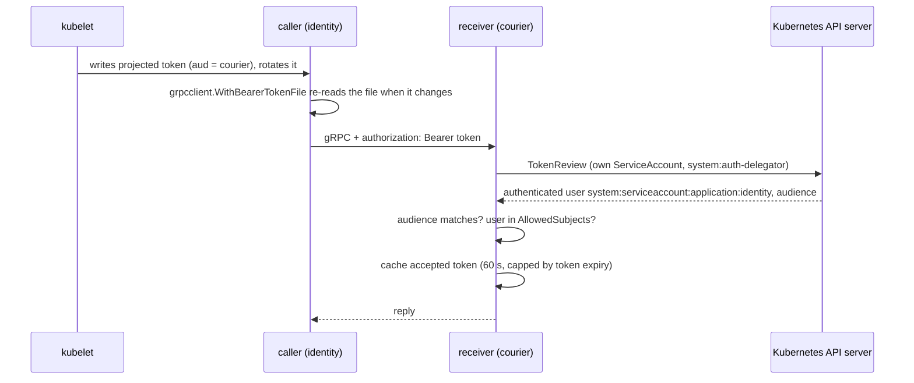
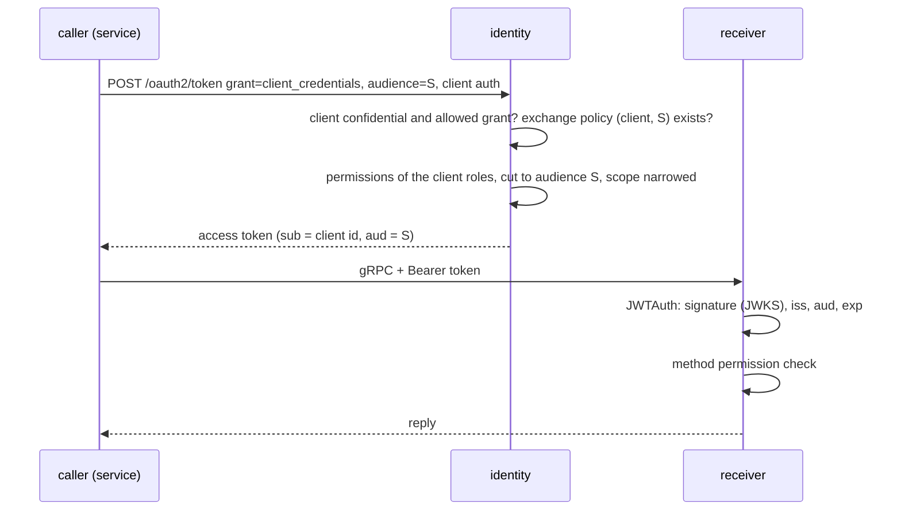
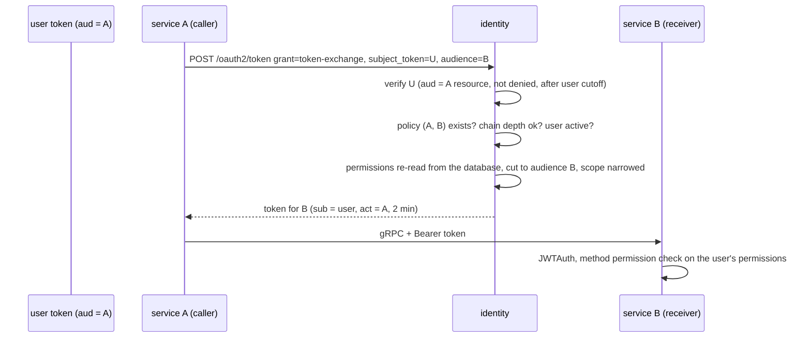

# Authentication between services

This document lists every way a service can prove who it is when it calls another service, which
code implements it, what the receiver learns, and when to use it. For the user-facing flows see
[flows.md](flows.md) and [api-call-flow.md](api-call-flow.md).

Calls between services are gRPC with the header `authorization: Bearer <token>`. What the token is
changes with the method. The receiver side is `gocommon/grpcserver`, the caller side is
`gocommon/grpcclient`, and the token source is `gocommon/tokenexchange` (talking to identity).

## 1. The methods at a glance

| # | Method | Token | Who the receiver sees | Needs identity | Secrets to manage | Typical use |
| --- | --- | --- | --- | --- | --- | --- |
| 1 | Kubernetes ServiceAccount token | Projected ServiceAccount JWT, checked with `TokenReview` | A service (`system:serviceaccount:<ns>:<name>`) | No | None (kubelet rotates the file) | Service to service inside the cluster, with no user: identity to courier |
| 2 | Static Bearer token | A shared string | "Someone who has the string" | No | One shared secret | Local development only |
| 3 | Client credentials (service JWT) | JWT from identity, `sub` = client id | A service, with the permissions of its roles | Yes | Client secret (vault) | Jobs and calls that are not on behalf of a user, when the receiver uses permissions |
| 4 | Token exchange (on behalf of a user) | JWT from identity, `sub` = user, `act` = caller | The user, and the service that acts for them | Yes | Client secret of the caller | Gateway to service, and a service that calls another service for the same user |
| 5 | Exchange of a service token | JWT from identity, `sub` = service, `act` = caller | A service, forwarded by a gateway | Yes | Client secret of the caller | A service calls the gateway, which calls an upstream |

Methods 3, 4 and 5 are all JWT. Method 1 is used when the receiver only needs to know which service
called. The receiver can accept several methods at once (section 7).



## 2. Method 1 — Kubernetes ServiceAccount token

The caller proves its identity with a projected ServiceAccount token. The receiver asks the
Kubernetes API server whether the token is valid.



| Side | Code | Configuration |
| --- | --- | --- |
| Receiver | `grpcserver.WithKubeAuth(KubeAuthConfig{Audience, AllowedSubjects})` (`gocommon/grpcserver/kubeauth.go`). `CallerFromContext(ctx)` returns the caller name. | Courier: `COURIER_AUTH_AUDIENCE`, `COURIER_AUTH_ALLOWED` (list of `namespace:name` or the full form). Chart value `rbac.authDelegator: true` binds the ServiceAccount to `system:auth-delegator`, which `TokenReview` needs. |
| Caller | `grpcclient.WithBearerTokenFile(path)` (`gocommon/grpcclient/tokenfile.go`) | Identity: `COURIER_TOKEN_FILE`. The deployment mounts a projected `serviceAccountToken` volume with `audience: courier` (see `charts/charts/go-application/ci/auth-values.yaml`) and uses its own ServiceAccount (not `default`). |

Properties:

- No secret to create, store or rotate. The token is short lived and bound to an audience.
- The receiver trusts the caller by name. An empty `AllowedSubjects` rejects every caller, and the service starts with a warning.
- Errors: unknown or wrong audience `Unauthenticated`; caller not listed `PermissionDenied`; API server failure `Unavailable` (fail closed).
- A revoked token can still pass for up to `CacheTTL` (60 s).
- There is no user and no `Principal`. With `WithMethodPermissions`, a caller authenticated only by KubeAuth is trusted for every mapped method: its allow list is its authorization. A method missing from the map is refused for everybody.
- Health checks (`/grpc.health.v1.Health/*`) skip authentication. Reflection does not.
- From a laptop use a short token: `kubectl create token <sa> -n <ns> --audience courier --duration 10m`.

Used today: identity calls courier to send e-mails (`identity/internal/notify`), courier accepts only listed ServiceAccounts.

## 3. Method 2 — static Bearer token (local only)

| Side | Code | Configuration |
| --- | --- | --- |
| Receiver | `grpcserver.WithBearerAuth(token)` or `WithOptionalBearerAuth` (`grpcserver/auth.go`), constant time compare | Identity: `IDENTITY_S2S_TOKEN`, honoured **only when `ENV=local`** (`cmd/identity/main.go`). Courier does not use it: with `ENV=local` it makes auth optional, otherwise it requires KubeAuth. |
| Caller | `grpcclient.WithBearerToken(token)` | Identity: `COURIER_S2S_TOKEN` as the token it sends to courier (used when `COURIER_TOKEN_FILE` is empty) |

- One shared string, no audience, no identity of the caller, no expiry. Never use it outside a laptop. Services ignore it unless `ENV=local`.
- It exists so that a developer can run services without a cluster or an identity.

## 4. Method 3 — client credentials (service JWT)

The service logs in to identity as an OAuth confidential client and gets a JWT for the receiver.



| Side | Code |
| --- | --- |
| Identity | `oauth.grantClientCredentials` (`internal/oauth/tokens.go`) |
| Caller | `grpcclient.WithServiceToken(provider, "<receiver audience>")` with a `tokenexchange.Client` (`ServiceToken`), token cached until shortly before it expires |
| Receiver | `grpcserver.JWTAuth(verifier)` plus `WithMethodPermissions` |

Setup (once per service):

```bash
identityctl client create --id billing-job --type confidential --resource billing-job \
  --grant client_credentials
identityctl client role --id billing-job --role billing-writer       # permissions come from roles
identityctl exchange set --client billing-job --audience courier --max-scope "..."  # may ask tokens for courier
```

Put the printed secret in the vault of `mm-ansible` and mount it as the client secret of the service.

Properties:

- The receiver sees `sub` = client id, `client_id`, the roles, and only the permissions whose first segment is the receiver (`FilterPerms`). `Principal.IsService()` is true.
- Authorization is by permissions of the roles, managed in identity (database), not in each service.
- A policy row (client, audience) is required: deny by default. `max_scope` limits the scope.
- Lifetime `IDENTITY_ACCESS_TOKEN_TTL` (10 min, or the client `AccessTokenTTL`). No refresh token: ask again, the client caches it.
- Needs identity to be reachable. If identity is down, tokens already cached keep working until they expire.
- A token can be revoked by `jti` (`state.Deny`) but a receiver that verifies locally only sees it after expiry; keep the lifetime short.

## 5. Method 4 — token exchange on behalf of a user

When the call is made because of a user, the receiver must know who the user is, and which service acts
for them. The caller trades the user's token for a token for the receiver (RFC 8693).



| Side | Code |
| --- | --- |
| Identity | `oauth.grantExchange`, `token.Service.Exchange` |
| Caller | `grpcclient.WithTokenExchange(provider, "<audience>")`: exchanges the token of the request principal (`authn.FromContext`, filled by `JWTAuth`); with no principal (a background job) it falls back to method 3. The gatekeeper does the same explicitly with `ExchangeToken`. |
| Receiver | `JWTAuth`, `Principal.Actor` / `ActorChain()` for the delegation chain (`gatekeeper>billing`) |

Setup:

```bash
identityctl client create --id gatekeeper --type confidential --resource gatekeeper ... \
  --grant urn:ietf:params:oauth:grant-type:token-exchange
identityctl exchange set --client gatekeeper --audience identity --depth 1
```

Rules enforced by identity (`token.Service.Exchange`):

| Rule | Effect |
| --- | --- |
| The caller is a confidential client with the token-exchange grant | Public clients cannot exchange |
| The subject token is a live access token whose audience is the caller's `resource` | A token meant for another service is refused |
| A policy row (caller, audience) exists | Deny by default |
| `Act.Depth()+1 <= max_chain_depth` (1 to 5) | Limits delegation chains (A calls B calls C) |
| The user is active, permissions read again from the database | A role change or a disabled user applies at once |
| Scope can only narrow (token scope, policy `max_scope`) | No privilege escalation |
| Permissions are cut to the audience | A service never sees the permissions of another |
| Lifetime at most 2 minutes, at most what is left of the user token | Short lived |
| Token issued before the user cutoff or on the denylist is refused | Revocation works |
| `act = {sub: caller}` is added (previous `act` kept) | The receiver and the logs know who acted |

The receiver sees the **user** as `sub` and checks the **user's** permissions. This is what makes a gRPC method safe
to expose through the gateway: the same checks hold if the call comes from another service.

Used today: gatekeeper to identity (and to any upstream in `routes.yaml`).

## 6. Method 5 — exchange of a service token (forwarding)

A service with a client credentials token can call the gateway (audience `gatekeeper`), and the gateway
exchanges that token for the upstream. `token.Service.Exchange` detects `subject == client_id`:

- The new token keeps the **service** as `sub` and carries the permissions of the service roles on the upstream audience.
- `act` is the gateway.
- Setup: the service has a client with `client_credentials`, a role, and `identityctl exchange set --client <service> --audience gatekeeper`. The gateway needs its own policy (gatekeeper, upstream) as usual.

See the README of the gatekeeper, "Adding a service that calls the gateway".

## 7. The receiver: how several methods combine

A receiver can accept more than one method. In `gocommon/grpcserver`:

- `AnyAuth(fn1, fn2, ...)` tries each in order and accepts if one accepts. Put cheap local checks (JWT) before remote ones (KubeAuth). When none accepts, the first error that is not `Unauthenticated` wins.
- Identity uses `AnyAuth(JWTAuth)`, plus the static token when `ENV=local` (`cmd/identity/main.go`). Courier uses KubeAuth outside local.

Authorization is a separate step, `WithMethodPermissions(map[method]permission)` (`grpcserver/jwtauth.go`, `checkMethod`):

| Caller authenticated by | Result |
| --- | --- |
| JWT (a `Principal` exists) | Must hold the permission of the method (`authz.Allowed`, wildcards apply), or the method is `grpcserver.Public` (any authenticated caller) |
| KubeAuth only (no `Principal`, a caller name exists) | Trusted for every mapped method |
| Nothing | `Unauthenticated` |
| Method not in the map | `PermissionDenied` for everybody (deny by default) |

For HTTP services the same ideas exist as `httpx.JWTAuth(verifier)` and `httpx.RequirePermission("...")`.

## 8. Choosing

| Situation | Use |
| --- | --- |
| Internal job, no user, the receiver only needs an allow list | 1 (ServiceAccount token) |
| Internal job, no user, the receiver checks permissions by role | 3 (client credentials) |
| A user clicked something and service A calls B | 4 (exchange) |
| A browser, mobile app or service calls the platform from outside | Through the gatekeeper: cookie or Bearer, then 4 or 5 |
| Local development without Kubernetes | 2 (static token, `ENV=local`) |
| A service must not act as a user | Never exchange a user token for it: use 3 |

Mixing is normal: courier accepts only method 1; identity accepts JWT (3, 4, 5); a service that serves the
gateway accepts JWT with audience equal to its own name.

## 9. Common settings for every JWT receiver

| Setting | Meaning |
| --- | --- |
| Issuer | The identity issuer URL, must match `iss` |
| Audience | The name of the receiver. It accepts only tokens whose `aud` is its own name |
| Keys | JWKS of identity (`.well-known/jwks.json`), cached; or the in-process key set for identity itself (`jwtx.StaticKeySet`) |
| Token type | Only `typ=access` is accepted (an ID or logout token is refused) |
| Failure mode | Invalid token `Unauthenticated`; JWKS not reachable `Unavailable` (fail closed, no logout) |

## 10. Security notes

- **Audience is the main fence.** A token for service B is useless at service C. Do not accept tokens without checking `aud`.
- **Prefer short lifetimes.** Exchange tokens last 2 minutes; access tokens 10 minutes. A revoked token is only caught early by services that call introspection or exchange, never by pure local verification.
- **Deny by default everywhere**: exchange policy, client roles, `WithMethodPermissions`, `AllowedSubjects`, routes without `permission`.
- **Never log tokens.** The server interceptor logs `sub`, `jti`, `client_id`, `act` and the caller name instead.
- **Do not forward a user token as is.** Exchange it, so the audience, scope and lifetime fit the receiver. The chain is visible in `act`.
- **Secrets**: client secrets live in the vault of `mm-ansible` (see its README, "Identity and gatekeeper secrets"), never in `mm-deploy` values. Method 1 needs no secret at all, which is why it is preferred where no user is involved and an allow list is enough.
- **Transport**: inside the cluster the default is plaintext gRPC (`grpcclient.WithInsecure(true)`, `GATEKEEPER_UPSTREAM_INSECURE`). The bearer token is therefore protected by the network of the cluster. Use `grpcclient.WithTLS` (or a mesh) when that is not enough.

## 11. Where each piece is in the code

| Piece | Location |
| --- | --- |
| ServiceAccount token check | `gocommon/grpcserver/kubeauth.go` |
| Static token | `gocommon/grpcserver/auth.go`, `gocommon/grpcclient/options.go` (`WithBearerToken`) |
| Token file (projected token) | `gocommon/grpcclient/tokenfile.go` (`WithBearerTokenFile`) |
| JWT receiver, `AnyAuth`, method permissions | `gocommon/grpcserver/jwtauth.go` |
| Service token, exchange on the caller side | `gocommon/tokenexchange/tokenexchange.go`, `gocommon/grpcclient/jwt.go` (`WithServiceToken`, `WithTokenExchange`) |
| `Principal`, `Can`, `IsService`, `ActorChain` | `gocommon/authn/authn.go` |
| Client credentials and exchange in identity | `identity/internal/oauth/tokens.go`, `identity/internal/token/token.go` |
| Policies, client roles | `identityctl exchange`, `identityctl client role`; gRPC `SetExchangePolicy`, `AssignRole` |
| Receiver wiring examples | `identity/cmd/identity/main.go`, `courier/internal/auth/auth.go` |
